# ccpipe

<p align="center">
  
</p>

ccpipe is a web front-end for [Claude Code](https://claude.com/claude-code)
sessions running in tmux. Install it on the workstation, server, or VM
where you already run `claude` from a terminal; ccpipe attaches a
browser tab to that same tmux session over a WebSocket.

Real-world example: a headless dev VM in a homelab — no monitor, no
soundcard, no microphone. SSH in once to start `claude` inside tmux,
then `systemctl --user start ccpipe`. From then on, opening
`https://your-host` on a phone or laptop gives you the live terminal:
keystrokes, scrollback, `/voice` dictation, spoken replies. The VM
needs no audio hardware — the microphone is a software-only Pulse
pipe-source that ccpipe writes PCM into, and TTS plays back in the
browser.

Terminal stack unchanged: tmux owns the session, xterm.js renders it,
the unmodified `claude` CLI does the API work. ccpipe is the bridge in
the middle.

## What it looks like

The screenshots come from a demo machine with sample projects.

Mobile (PWA, installable to the home screen):

<table>
<tr>
<td align="center">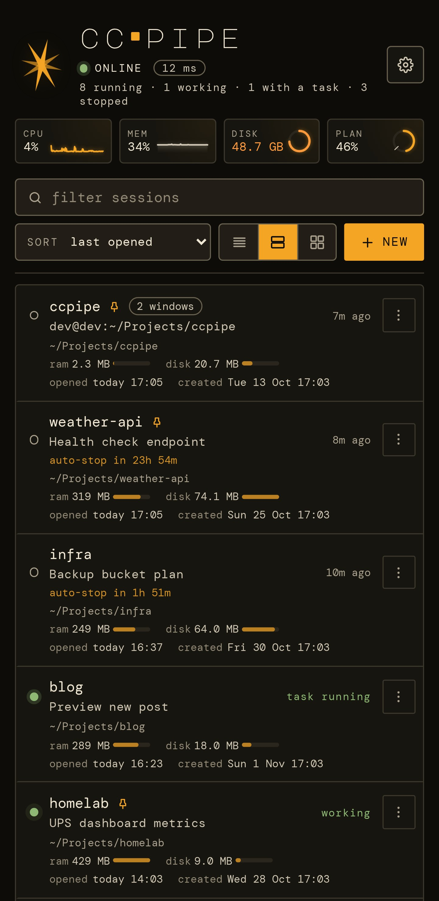</td>
<td align="center">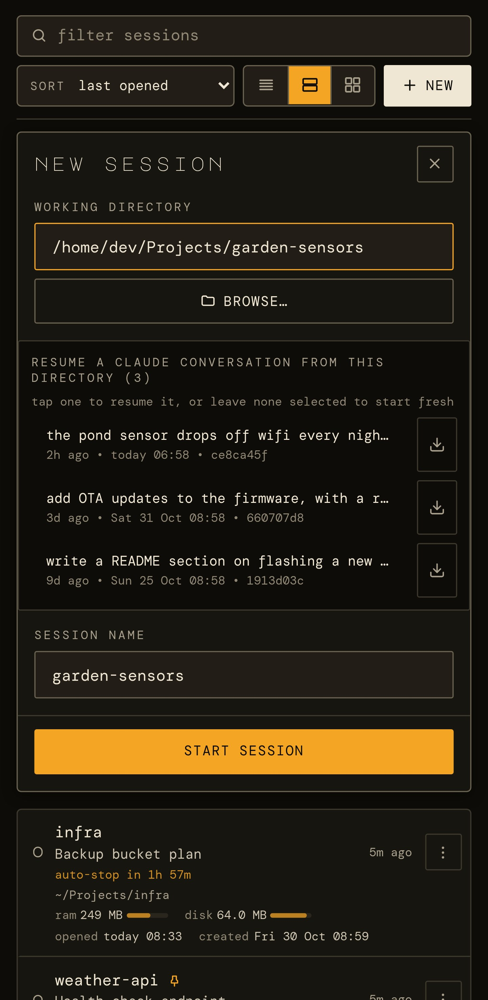</td>
<td align="center">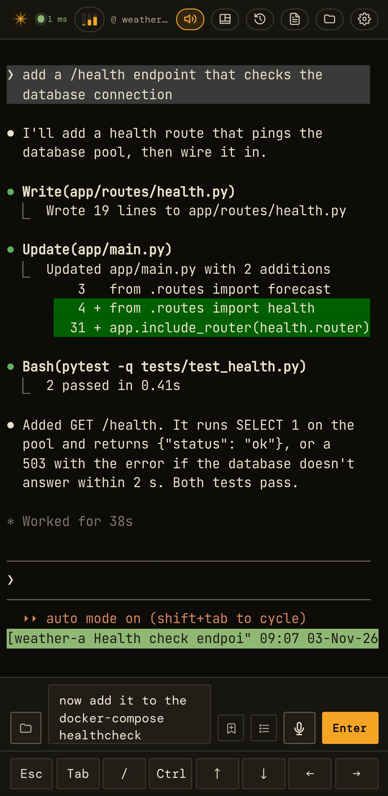</td>
<td align="center">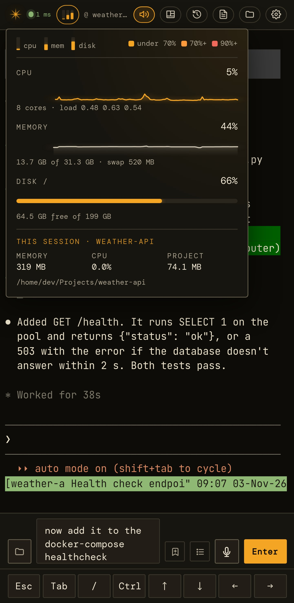</td>
</tr>
<tr>
<td align="center"><sub>Every session, running or stopped…</sub></td>
<td align="center"><sub>…start one in any directory, or resume an earlier conversation…</sub></td>
<td align="center"><sub>…then drive it by keyboard, prompt box or voice.</sub></td>
<td align="center"><sub>Tap the meter for the machine's status.</sub></td>
</tr>
</table>

Desktop:

<p align="center">
  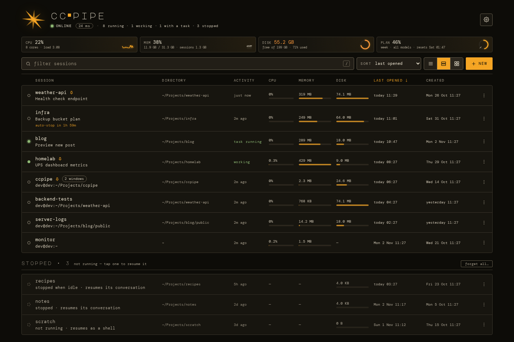
</p>

<table>
<tr>
<td align="center">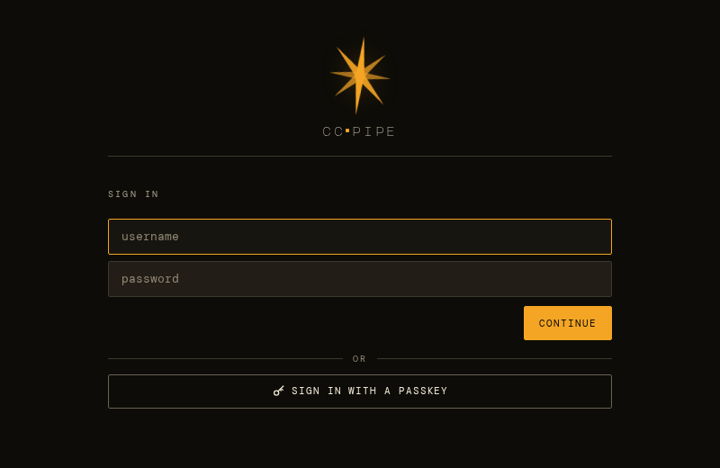</td>
<td align="center">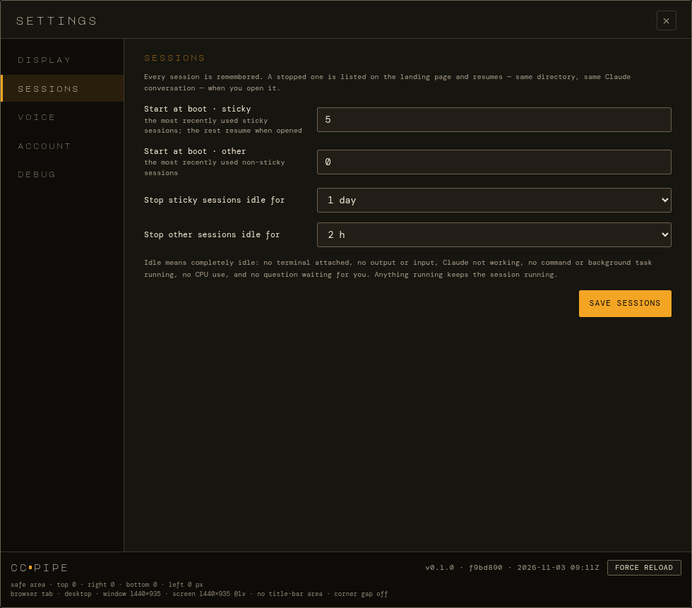</td>
</tr>
<tr>
<td align="center"><sub>Login</sub></td>
<td align="center"><sub>Sessions — start at boot, idle stop</sub></td>
</tr>
<tr>
<td align="center">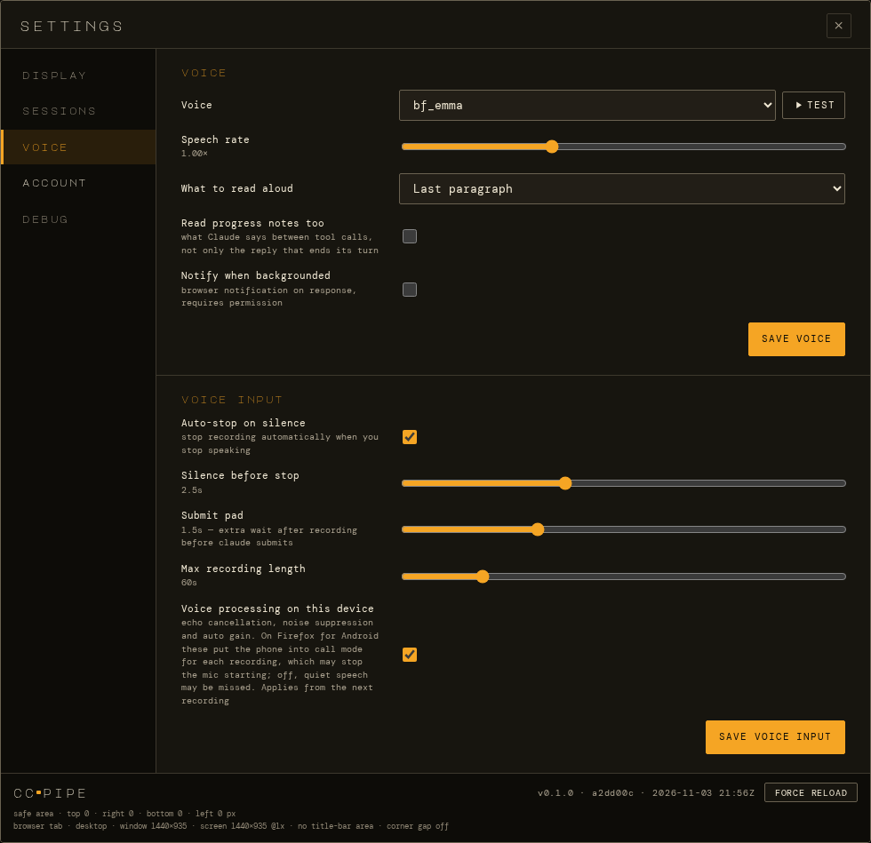</td>
<td align="center">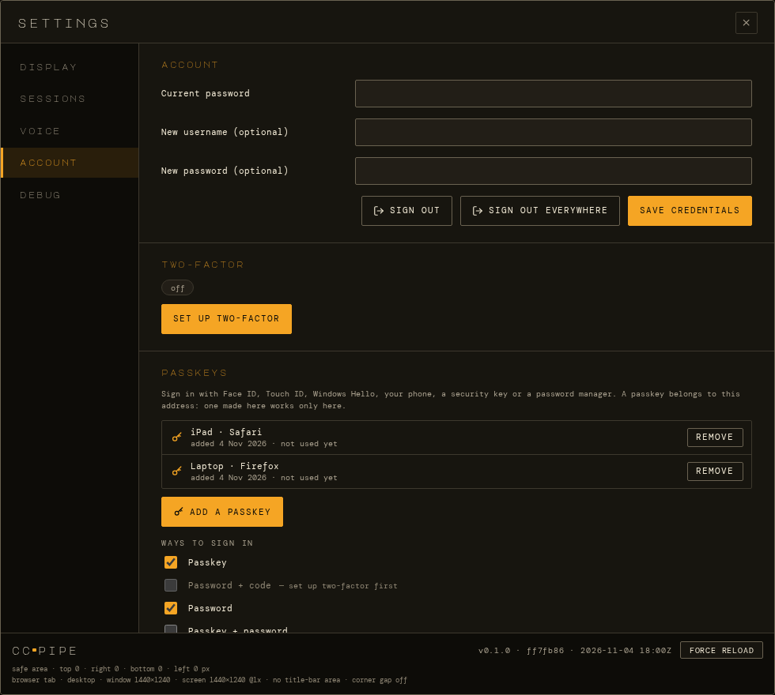</td>
</tr>
<tr>
<td align="center"><sub>Voice (TTS) + voice-input timings</sub></td>
<td align="center"><sub>Account, sign out everywhere, two-factor (TOTP)</sub></td>
</tr>
</table>

**Session list.** The landing page lists every session, running or
stopped. The header shows whether the server is online, the round-trip
time, and a summary such as *8 running · 1 working · 1 with a task ·
3 stopped*. Below it are the machine's CPU and memory, each with ten
minutes of history, and its free disk space. Each session shows:

- what Claude is working on: the task Claude Code puts in the pane
  title;
- its state: **working** while Claude is on a turn, **task running**
  while a background shell task runs, idle otherwise, and **open**
  while a terminal is attached somewhere;
- its directory, memory, project size, and when it was last active,
  last opened and first created;
- a pin if it's sticky, and how many windows it has;
- **auto-stop in 1h 57m** when it's idle and will be stopped (see below).

Filter by name, task or directory (`/` jumps to the filter box), sort by
recent activity, last opened, newest, name, memory or disk, and pick a
compact list, a detailed table, or a grid of live screen previews. Each
session's `⋮` menu opens, renames, stops or forgets it, or makes it
sticky. Settings → Display → *status & graphs* turns the system panel and
the per-session figures off on that device.

<p align="center">
  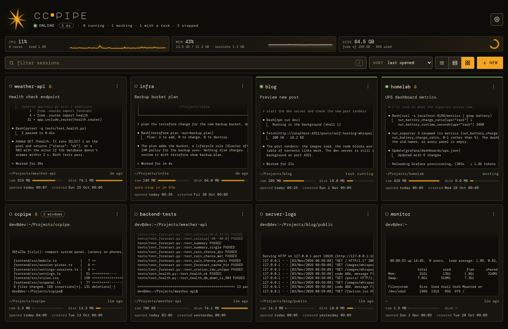
</p>

**Sessions are remembered.** A session that isn't running stays on the
list under **stopped**. That happens after a reboot, after an idle stop,
or after you stop it from its menu. Tap it and it comes back: same name,
same directory, and `claude --resume` on the conversation it was on. A
session that never ran Claude (a shell you started over ssh, say)
resumes as a shell in its directory instead. *Forget* removes a session
for good. Under Settings → Sessions:

- **Start at boot:** after a reboot, only the most recently used few
  start by themselves: 5 sticky sessions and 0 others by default. The
  rest wait until you open them. Restarting ccpipe (a deploy, say)
  starts nothing and leaves stopped sessions stopped.
- **Idle stop:** sessions that sit idle are stopped to free their
  memory, after 1 day for sticky sessions and 2 hours for others
  (0 = never). Idle is deliberately hard to reach. A session counts as
  in use while any of these holds:
  - a terminal is attached;
  - its pane shows output;
  - Claude is working, or has a background task or tool command
    running;
  - anything else runs in its shell;
  - it uses CPU;
  - a question or permission prompt is waiting.

  Only sessions running Claude are ever stopped, and every stop is
  logged.
- **When it can't resume:** if the directory was deleted, opening the
  session says so and leaves its record alone. It never quietly starts
  a fresh Claude in `$HOME`.
- **When a terminal is open on a stopped session:** stopping or
  forgetting a session that a terminal has open sends that terminal
  back to the list with a note ("weather-api was stopped") rather than
  reconnecting.

The details are in
[`docs/configuration.md`](docs/configuration.md#remembered-stopped-and-sticky-sessions).

**Claude's working state.** ccpipe takes "is Claude working" from Claude
Code's own status file (`~/.claude/sessions/<pid>.json`: busy, idle, or
idle with a background shell task). It doesn't guess from the screen,
so a long tool call that prints nothing for minutes still counts as
working.

**System status in every session.** Beside the ping in a session's top
bar:

- On a wide screen there's a CPU graph, memory and disk bars, and the
  project's size.
- On a phone or a narrow window that becomes three thin bars: CPU,
  memory and disk, from left to right. Each bar is amber below 70 %,
  orange from 70 % and red from 90 %.

Click or tap it for a pop-up with the graphs, the exact figures, and
this session's own memory (the PSS of its whole process tree), CPU and
project size. On the compact meter the pop-up starts with a key to the
bars. Tapping it on a phone doesn't close the soft keyboard. Each part
can be switched off per device, and the refresh interval set (2–30 s).
A part that's switched off stops asking the server too.

<p align="center">
  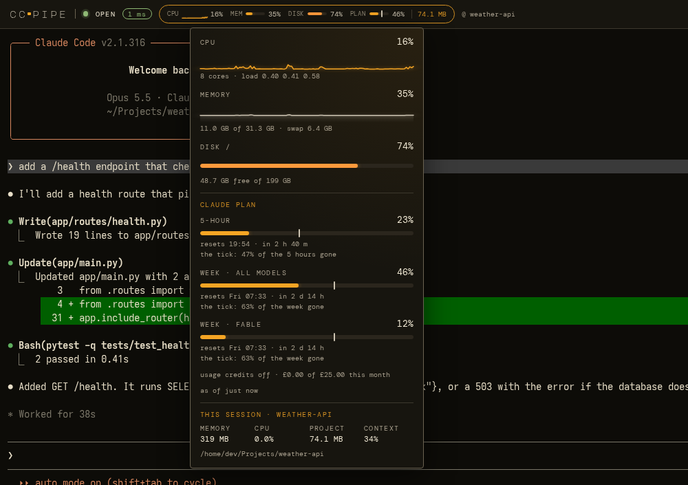
</p>

**Starting a session.** **+ new** opens a panel: pick a working
directory (type it or **browse…**) and a session name, which is filled
in from the directory. If Claude has conversations from that directory,
they're listed by their first prompt and age. Tap one to resume it, or
leave none selected to start fresh. The ↓ beside each one downloads that
conversation as Markdown.

**File browser.** The toolbar **Files** button opens a file browser at
the session's project folder: view, upload, create folders, rename,
delete, edit text files in place, and download. A whole folder downloads as a
**.zip**, from a folder's ⋮ menu or the **zip** button for the folder
you're in. It first shows how many files and how much data that is, and
leaves hidden files (`.git`, `.venv`, …) out unless you choose to include
them. The zip is built as it downloads, so there's no wait for a big
folder to be packed first.

- **Upload** takes any number of files at once, from the picker or
  dropped onto the panel, up to 500 MB each (`fs.upload_limit_mb` in
  `config.json`). It asks before replacing files that are already
  there. Files travel in pieces of at most 8 MB, so a proxy's limit on
  request size (nginx, Cloudflare) doesn't cap them.
- **Built for bad connections.** Uploads go in pieces, and a piece that
  fails is retried after a growing pause, from however much the server
  says has arrived. A dropped signal costs only the piece in flight, and
  coming back online retries at once. Downloads are fetched the same
  way, in byte ranges. Each transfer shows its progress, speed and, on a
  bad link, *retrying in 4 s*; cancel or retry it from the list. Closing
  the panel doesn't stop a transfer, and the page won't reload itself
  for an update while one is running.

**File viewer.** Tapping a file opens it read-only, full screen; **✎**
switches to the editor, and you're back in the viewer when you close it.

- **Text and code:** syntax-highlighted, with line numbers and a wrap
  toggle.
- **Markdown:** rendered (the document viewer below), with a switch to
  the source.
- **Images:** fitted to the screen. Pinch, scroll or double-tap to zoom,
  and drag to pan. SVGs show as images, so any script in one never runs.
- **PDF, audio and video:** the browser's own viewer and players.
  Seeking works.

**‹ ›**, the arrow keys, or a swipe on an image step through the
folder's files. **⤓** downloads the file, and **↗** opens it in a tab of
its own.

<p align="center">
  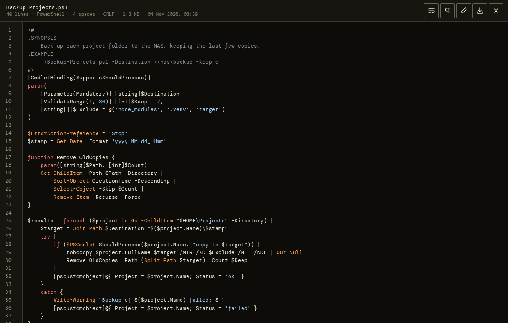
</p>
<p align="center">
  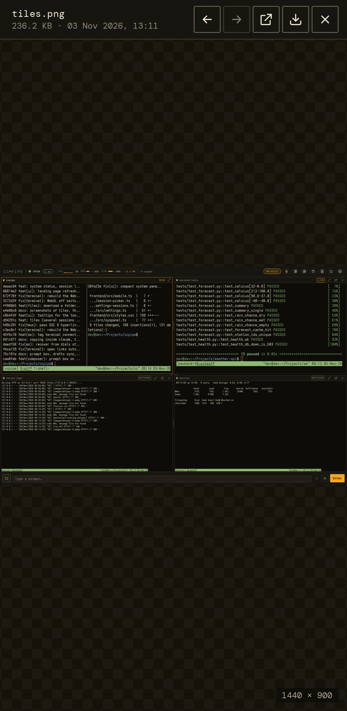
  &nbsp;
  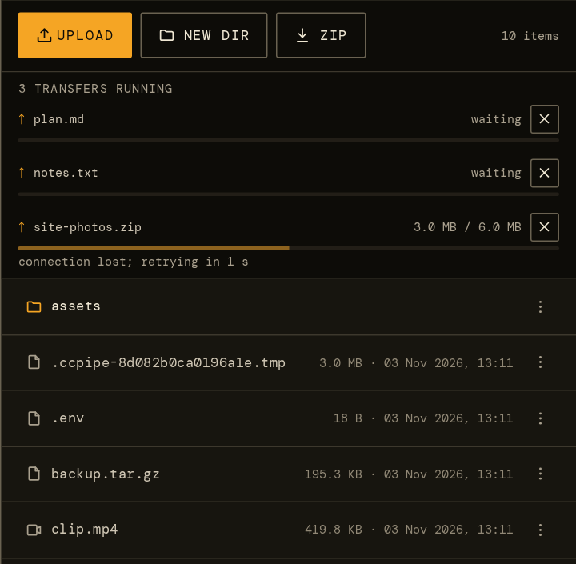
</p>

<p align="center">
  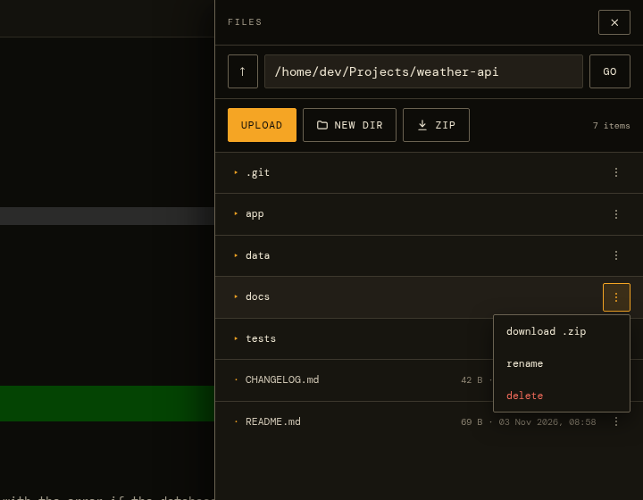
</p>

**Document viewer.** Any Markdown file in your project opens fully rendered
in its own browser tab — GitHub-flavoured, with syntax highlighting, KaTeX
math, and Mermaid diagrams. Open one from the file browser, the editor's
preview button, or the toolbar **Docs** menu, which leads with your
**Recent** documents and the **Recently modified** ones (with ages) above
every `.md` under the session's project root. It **live-updates**: edit the
file — or let `claude` edit it — and the rendered view refreshes in place
without moving your scroll position (bursts of edits are coalesced, and
unchanged diagrams aren't redrawn). Images and relative links resolve
against the document's own directory. The page is served with its own
tightened CSP, separate from the terminal app.

Inside the viewer, **docs** opens a document drawer: type to search every
Markdown file in the project (ranked, highlighted matches), or browse a
folder tree that opens along the current document's path — with the same
Recent / Recently modified sections on top. It docks beside the document on
wide screens and is a full-height sheet on phones; `/` opens it from the
keyboard. When ccpipe is installed as an app (no tab strip or back button),
the **✕** at the top right of the viewer and the history view closes it and
returns you to the terminal.

<p align="center">
  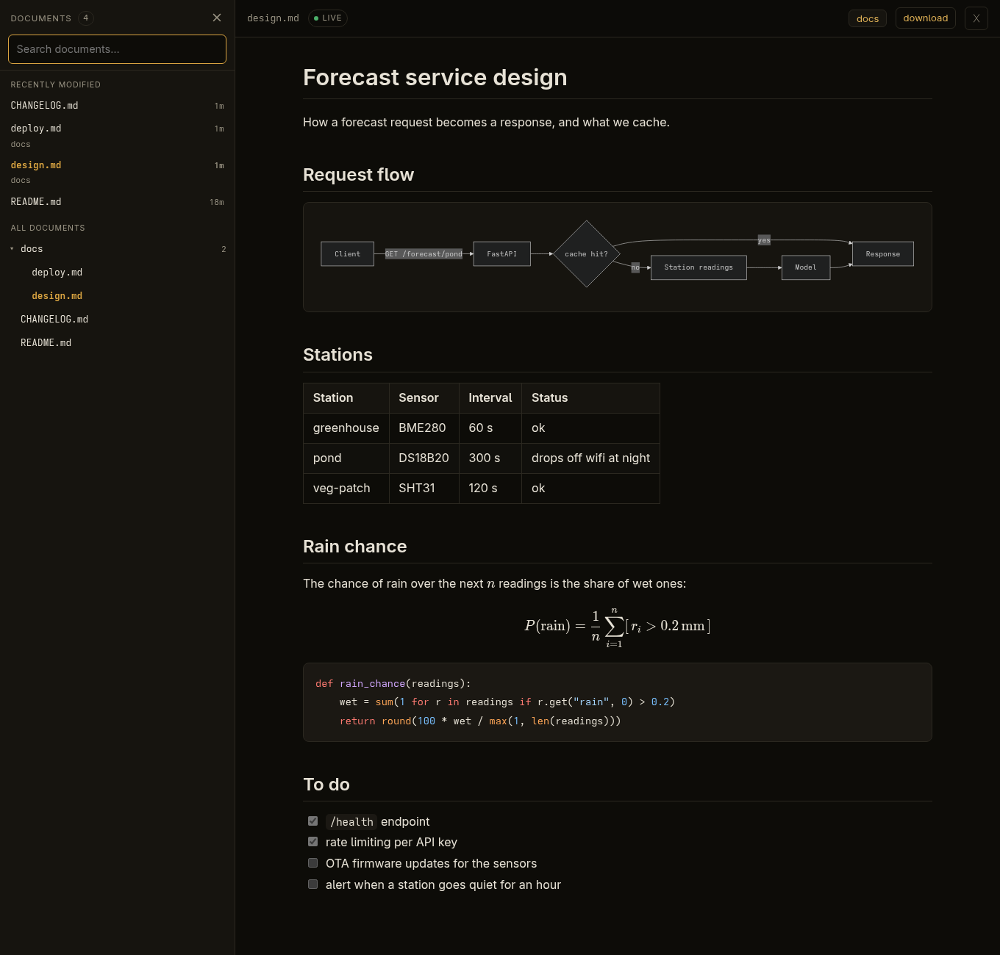
</p>

**Conversation history.** The toolbar **🕘 History** button opens a
console-style, Markdown-rendered view of the session's Claude Code transcript
in its own tab. It shows the whole conversation — your prompts, Claude's
replies (rendered Markdown: headings, lists, tables, syntax-highlighted code),
and **the commands run and files edited inline** (`$ …` shell commands, `✎`
edits with `-/+` diffs). It **live-tails** — new replies and tool calls stream
in as they happen, no refresh, following the bottom while you're reading it —
and lazy-pages older history as you scroll up. Claude Code's full-screen TUI
keeps no scrollback of its own, so this is the place to scroll back through
what actually happened. On mobile, in-terminal touch-scroll is forwarded to
Claude as wheel events, so dragging up scrolls Claude's own view (clean), the
same as a desktop mouse wheel.

<p align="center">
  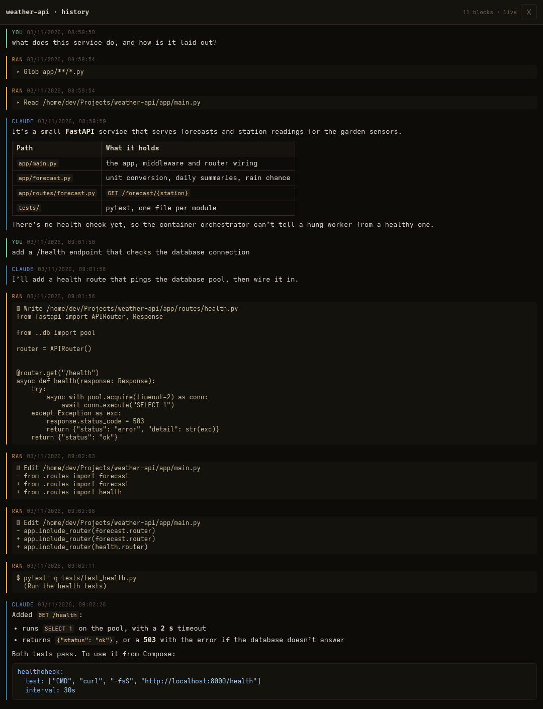
</p>

**Prompt box.** Under the terminal — on phones, tablets and desktop — is a
prompt box for composing longer prompts before sending them with **Enter**.
Whatever you type is the session's **draft**: it's kept on the server, comes
back whenever you re-enter the session, and **syncs live between devices**
(type on the phone, see it appear on the iPad; the last edit wins). Sending
clears it everywhere. Two small buttons beside it manage **saved prompts**:
the bookmark saves the box's contents under a name, and the list button
drops down your saved prompts (filterable, with a preview and delete) and
inserts the one you pick at the cursor. Saved prompts are shared by every
session and every device. On desktop, keystrokes still go straight to the
terminal until you click into the box.

**Dictation.** Tap the mic and talk; tap it again, or just stop
talking, to send. A waveform shows it's hearing you. The audio goes to Claude Code's own `/voice`
through the software mic, and Claude transcribes it into the prompt.
ccpipe starts and stops Claude's recording itself and checks Claude's
screen each time, so the two stay in step:

- **Start again straight away** and both recordings go through. If
  Claude is still transcribing the last one, the mic waits for it
  (*Waiting for Claude to finish the last recording…*).
- **Claude recording on its own** (you pressed Alt+K in the terminal,
  say) shows *Claude is listening · tap to talk*; tap it and talk into
  that recording.
- **One device at a time:** while one device dictates, the mic on
  another says it's in use.
- **If the mic can't start,** a message says why: access refused, no
  microphone, or *tap the mic to try again*.

On Firefox for Android, voice processing (echo cancellation, noise
suppression, auto gain) puts the phone into call mode for each
recording, which looks to be why the mic occasionally failed to start
there. It's on by default, because Claude hears you better with it; a
switch in Settings → Voice turns it off on one device alone.

**Phones and tablets.** Installed to the home screen, ccpipe runs full
screen:

- **Keys:** a row of keys sits above the soft keyboard: Esc, Tab, `/`,
  Ctrl and the arrows. Phone keyboards can't send Ctrl combinations
  themselves.
- **Prompt box:** the folder button inserts a file or folder path, and
  the mic dictates.
- **Soft keyboard:** the terminal re-fits when the keyboard opens. The
  key row and the status meter keep the keyboard up when you tap them.
- **Top bar:** on a phone the back-to-sessions button is the spark mark,
  so the session name has room.
- **iPad:** iPadOS 26 draws its window buttons over the top-left corner
  of a home-screen app. ccpipe's top bar starts clear of them there, and
  the ✕ that closes the viewer and the history view sits top right for
  the same reason.
- **Display:** the terminal font is chosen per device. If letters come
  out garbled on one device, its WebGL renderer can be switched off
  there alone.

**Copying from the terminal.** Select text and it's copied to your
clipboard automatically — a toast confirms and previews what was copied.
Inside `claude`, which captures the mouse, a normal drag selects in Claude's
own UI and Claude copies it; hold **Shift** while dragging to select the
terminal text directly instead. Links printed in the terminal open in your
browser (a new tab, or the in-app browser on a phone), leaving ccpipe where
it was. A long link Claude wraps over several lines opens in full from any
of them.

**Tiles: several sessions on one screen.** On an iPad or a desktop, the
toolbar **tiles** button adds other sessions beside or below the terminal
you're in, so you can keep an eye on several at once. Drag the dividers to
resize, or pick a preset: side by side, grid, main + stack, stacked. Each
tile starts out **watching**: a read-only view that never resizes the
session, so watching a session doesn't reflow it on your other devices.
Click into a tile and start typing (or tap its *watching* label) and it
goes **live**: your keys, the prompt box and the tmux controls then act on
that session. A tile's header lights up when it has new output, **⤢**
gives it the whole screen for a moment, and **↗** makes it the main
session. Tiles are remembered per session, on the server: open the same
session on another device and its tiles come back. On a phone the screen is
too narrow, so the terminal stays full-screen and the tiles wait for a
bigger screen.

<p align="center">
  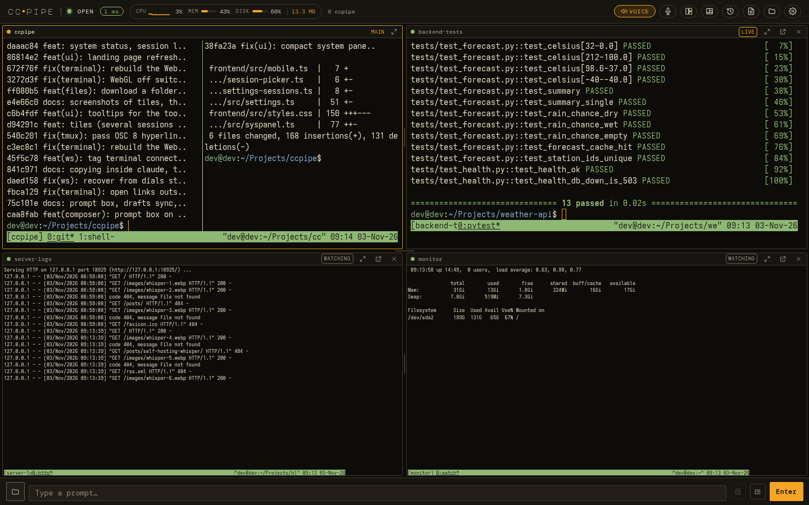
</p>
<p align="center">
  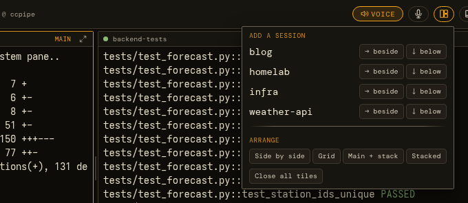
</p>

**tmux controls.** (Hover over any toolbar icon, or press and hold it on a
touch screen, to see what it does.) The toolbar **tmux** button opens a slim row of tmux
controls for the focused session: window tabs (click to switch), new,
rename and close window; split the pane side by side or top/bottom, next
pane, zoom, close pane; copy mode with page up/down; and a **C-b** prefix
key for anything else. Each button runs a fixed tmux command on the server,
so nothing you type there reaches tmux's command line.

<p align="center">
  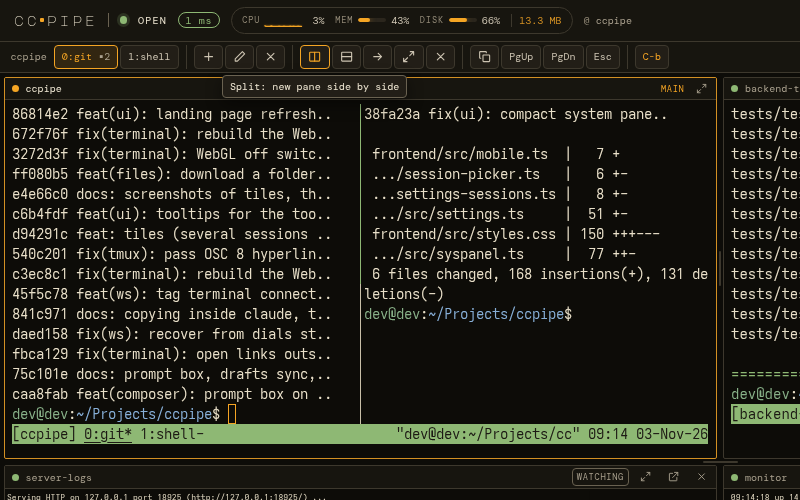
</p>

**Staying connected.** The terminal reconnects by itself — after a dropped
signal, switching between Wi-Fi and mobile data, or coming back to the app.
A connection attempt that gets stuck on a network that's gone is abandoned
after 10 seconds and retried, and returning to the app redials straight
away, so you shouldn't need to reload.

**Updates without a reload.** After a deploy, open pages move to the new
build by themselves, at a moment that loses nothing:

- straight away on the session list;
- otherwise when the app comes back from the background, or after ten
  idle minutes.

It never happens with a dialog open, mid-dictation, or while the
terminal is scrolled back. A small toast offers to reload sooner. Until
then the old page keeps working, because each build keeps the files of
the last three builds.

**Settings.** The gear opens Settings:

| Tab | What's in it |
|---|---|
| **Display** | Text size and spacing; the terminal font (per device); the cursor's style, colour and blink; the WebGL renderer switch; and *status & graphs*. Applies as you change it. |
| **Sessions** | How many sessions start at boot, and the idle stop times (above). |
| **Voice** | Text-to-speech: voice, speed, what to read aloud, and a notification when the app is in the background. Voice input: when dictation stops and is sent, and voice processing on this device. |
| **Account** | Change the username or password, sign out, sign out everywhere, set up two-factor (TOTP). |
| **Debug** | A diagnostic snapshot (Ctrl+Shift+D) for terminal display bugs. |

The footer shows the build the page is running, with **Force reload**
(**Update ready · reload** once a newer build is deployed). Under it is
a readout of what the screen reports: safe-area insets, window and
screen size, and whether the page is an installed app. That's handy for
checking the layout on a new device.

<p align="center">
  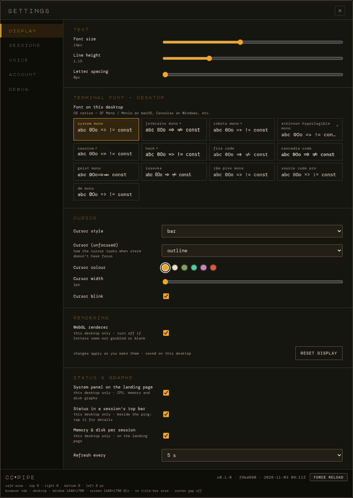
</p>

## Architecture

ccpipe runs as a `systemd --user` service on the host. No Docker — the
backend is tightly coupled to host state (tmux, `~/.claude`, project
files, PulseAudio, mic pipe) and containerising it created more
friction than it solved.

```
[Browser] ──WSS── [nginx] ── [uvicorn (user service)]
                                   │
                                   ├── tmux client (talks to user's tmux server)
                                   ├── /tmp/ccpipe_mic.pipe (Pulse pipe-source)
                                   ├── watches ~/.claude/projects/*.jsonl → Kokoro
                                   ├── reads ~/.claude/sessions/<pid>.json (Claude's busy / idle)
                                   └── reads /proc (system + per-session CPU, memory)
```

State it keeps (`~/.local/state/ccpipe`): credentials, settings, the
record of every session (directory, Claude conversation, times), sticky
sessions, prompt-box drafts, saved prompts and tile layouts. See
[`docs/configuration.md`](docs/configuration.md#where-state-lives).

## Prereqs

- Python 3.11+
- Node 20+ (frontend build only)
- `tmux` on PATH
- `claude` CLI installed and logged in (`claude` once interactively to
  complete OAuth)
- nginx or Caddy for TLS termination (sample in `nginx/ccpipe.conf`)
- PulseAudio or PipeWire (only needed for voice)

## Platform support

The server side has been built for and tested on **Linux**. The
browser client works on any modern browser (Linux, macOS, Windows,
Android, iOS) — that side is OS-agnostic.

| Target | Server-side status |
|---|---|
| Linux | Fully tested, this is what's actively used. |
| Windows via WSL2 | Should work — see below. Not tested by the maintainer; reports welcome. |
| Windows (native) | Not supported. Use WSL2 — a native port would have to replace systemd, the FIFO mic, PulseAudio, and the bash install script. |
| macOS | Experimental. launchd LaunchAgent + local whisper-cpp transcription. Ported without a Mac to test on; first real user gets to find the rough edges. See [`docs/macos.md`](docs/macos.md). |

### Windows (via WSL2)

Install WSL2 with a recent Linux distro from an elevated PowerShell:

```powershell
wsl --install                        # default Ubuntu
# or: wsl --install -d Debian
```

Reboot, open the Linux shell, then follow the [Linux install steps](#install)
inside it. WSL2 on current Windows builds supports `systemd --user`
(may need `systemd=true` under `[boot]` in `/etc/wsl.conf`) and
PulseAudio via WSLg. The browser on the Windows side connects to
`http://localhost:8080` (port-forwarded from WSL2 by default) or
whichever address you put behind a reverse proxy. Voice in/out across
the WSLg audio boundary hasn't been verified end-to-end — if you try
it, please report back.

### macOS

ccpipe runs as a `launchd` LaunchAgent under
`~/Library/LaunchAgents/`. Voice differs from Linux because `claude`'s
built-in `/voice` has an unfixed regression on macOS
([anthropics/claude-code#38690](https://github.com/anthropics/claude-code/issues/38690)) —
ccpipe transcribes locally via [whisper-cpp](https://github.com/ggerganov/whisper.cpp)
and types the result into the PTY. No virtual audio device or
Microphone-permission-on-Terminal-app dance needed.

Prereqs:

```bash
brew install python@3.11 node tmux whisper-cpp
brew install --cask claude-code   # if not already
```

Then follow the standard [Install](#install) steps below. `install.sh`
detects macOS, renders the launchd plist, and downloads the whisper
`base.en` model (~148 MB, sha256-pinned, one-time). Full design,
troubleshooting, and config knobs live in [`docs/macos.md`](docs/macos.md).

This port hasn't been tested on real Apple hardware — bug reports from
first-time users welcome.

## Install

Install into the home directory of the user ccpipe should run as —
it runs as a `systemd --user` service and needs read/write access to
that user's `~/.claude`, tmux server, and Pulse socket. The conventional
location is `~/.local/share/ccpipe` (under `$XDG_DATA_HOME`); the
installer is path-independent and bakes whichever directory you clone
into.

```bash
git clone https://github.com/<you>/ccpipe ~/.local/share/ccpipe
cd ~/.local/share/ccpipe
scripts/install.sh
```

The installer creates a self-contained Python venv under `backend/.venv`,
builds the frontend bundle, renders the systemd unit templates with the
current install location, and wires up the two `systemd --user` units.
Idempotent: re-run to upgrade.

Skip the systemd step on a dev box with `scripts/install.sh
--skip-units`. See [`docs/development.md`](docs/development.md) for a
fully manual setup and the dev workflow.

> First-run gotcha: if `ccpipe-virtual-mic.service` fails because
> `/tmp/ccpipe_mic.pipe` exists as a *directory* (leftover from a Docker
> bind-mount in a previous install), clean it up with
> `sudo rmdir /tmp/ccpipe_mic.pipe && systemctl --user restart
> ccpipe-virtual-mic`.

Check it's running:

```bash
systemctl --user status ccpipe
journalctl --user -u ccpipe -f
curl http://127.0.0.1:8080/api/health    # should print {"status":"ok"}
```

Then grab the initial password and log in:

```bash
cat ~/.local/state/ccpipe/initial_password.txt
shred -u ~/.local/state/ccpipe/initial_password.txt   # after reading
```

## Putting it on the internet

ccpipe runs HTTP only — terminate TLS in front of it with nginx or
Caddy. See [`docs/deployment.md`](docs/deployment.md) for the full
reverse-proxy + TLS + firewall recipe (off-host and same-host
topologies, the `CCPIPE_BEHIND_TLS=1` drop-in, what `--proxy-headers`
buys you, and the common gotchas).

The short version: edit `nginx/ccpipe.conf`, install the bundled
systemd drop-in template with `CCPIPE_BEHIND_TLS=1` and a tight
`--forwarded-allow-ips=<your-proxy-IP>`, and firewall `:8080` to the
proxy host.

## More

- [`docs/configuration.md`](docs/configuration.md) — env-var reference,
  voice setup, voice-input settings and dictation logs, the session
  lifecycle (start at boot, idle stop, resume), system status, where
  state lives.
- [`docs/deployment.md`](docs/deployment.md) — reverse proxy, TLS, the
  systemd drop-in, troubleshooting.
- [`docs/development.md`](docs/development.md) — dev workflow, layout,
  WebSocket protocol, tests.
- [`docs/debugging.md`](docs/debugging.md) — diagnostic playbook for
  the PTY → WebSocket byte stream (the "gap until I refresh" class
  of symptom): journal stats, live counter endpoint, regression
  tests, reproducer recipe.
- [`docs/threat-model.md`](docs/threat-model.md) — design-level threat
  model (post-pen-test).
- [`SECURITY.md`](SECURITY.md) — reporting vulnerabilities.

## Security / ToS notes

- **Pure PTY relay.** Subscription OAuth (Pro/Max) is fine for personal
  use **only** because the unmodified `claude` binary makes the API
  calls — ccpipe never originates a request to `api.anthropic.com`.
  See https://code.claude.com/docs/en/legal-and-compliance.
- **Always-on auth.** Passwords are argon2id-hashed on disk; the
  plaintext only ever exists in the read-once `initial_password.txt`
  sidecar (`0400`). Optional TOTP under Settings → Account. Login is a
  single request carrying password + code (the UI asks for them on two
  screens; leave the code blank if TOTP isn't set up), with one uniform
  error for any wrong part.
- **Session hardening.** Signed session cookie with `Secure` +
  `__Host-` prefix under `CCPIPE_BEHIND_TLS=1`, expiring after 30 days
  of disuse; logout revokes that login server-side and closes its
  terminal sockets; Settings → Account → "sign out everywhere" ends
  every session on every device. WebSocket Origin allow-list; CSRF
  defence via `X-Requested-By: ccpipe`; open sockets are closed when
  their session stops being valid (logout, password/TOTP change).
- **Login throttling.** Per-IP 5/min + global 300/min sliding window
  with a 1 s sleep on failure. No persistent banning — fail2ban reading
  `journalctl --user -u ccpipe` is the conventional add-on.
- **File panel scope.** `/api/fs/*` is jailed to `CCPIPE_FS_ROOT`
  (default `$HOME`). The jail enforces `Path.is_relative_to(root)`
  after symlink resolution, refuses non-regular files, and uses
  `O_NOFOLLOW` on temp-file opens. Saves keep the file's permission
  bits and write through symlinks only when the link's target also
  passes the jail. The denylist covers only ccpipe's own state
  (`~/.local/state/ccpipe`, `~/.config/ccpipe`) and Claude Code's
  (`~/.claude`, `~/.claude.json`); `.ssh`, `.aws`, `.gnupg`, `.kube`,
  etc. remain reachable because this is an admin tool. Folder downloads
  (.zip) walk the folder without following symlinks and leave out
  anything on the denylist, so zipping `$HOME` can't include `~/.claude`.
- **Files shown in the browser.** The viewer gets files from
  `/api/fs/inline`, which serves only a fixed list of image, SVG, PDF,
  audio and video types (by extension). Everything but PDF comes with
  `Content-Security-Policy: sandbox`, so a file opened in its own tab,
  an SVG with a script in it say, gets no origin and runs nothing. PDFs
  can't be sandboxed (browsers won't render them), but they render in
  the browser's PDF viewer, not as a page of ccpipe, and only ccpipe
  itself may frame one. Text is always fetched as data and shown as
  text.
- **Resumable uploads** write to a hidden `.ccpipe-….tmp` part-file
  beside the target, checked against the jail at the start and again at
  the finish, and renamed into place. Abandoned part-files are removed
  after a day, even across a restart.
- **TTS reads your Claude transcripts.** Only run ccpipe on a host
  where you trust everyone with access to those files.
- **Drafts and saved prompts live on the server.** Unsent prompt-box
  text and saved prompts are stored in plain text (`0600`) in ccpipe's
  state directory so they can follow you between devices.
- **Session records.** So stopped sessions can resume, ccpipe keeps each
  session's directory and Claude conversation id in `session_meta.json`
  (`0600`, state directory) until you forget it. Resuming runs only
  `claude --resume <id>` or `claude --continue` (or a shell), in a
  directory inside `CCPIPE_FS_ROOT`.
- **0.0.0.0 bind.** Required for an off-host proxy; firewall `:8080`
  to the proxy host (IPv6 too, if you bind `::` — see
  [`docs/deployment.md`](docs/deployment.md)). The startup banner
  reminds you when `CCPIPE_BEHIND_TLS=1` is set.

Full design-level threat model in
[`docs/threat-model.md`](docs/threat-model.md); vulnerability
reporting in [`SECURITY.md`](SECURITY.md).
