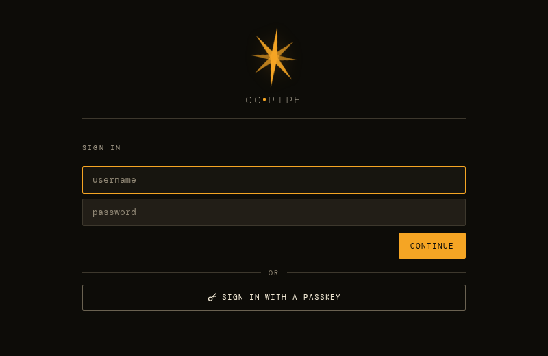
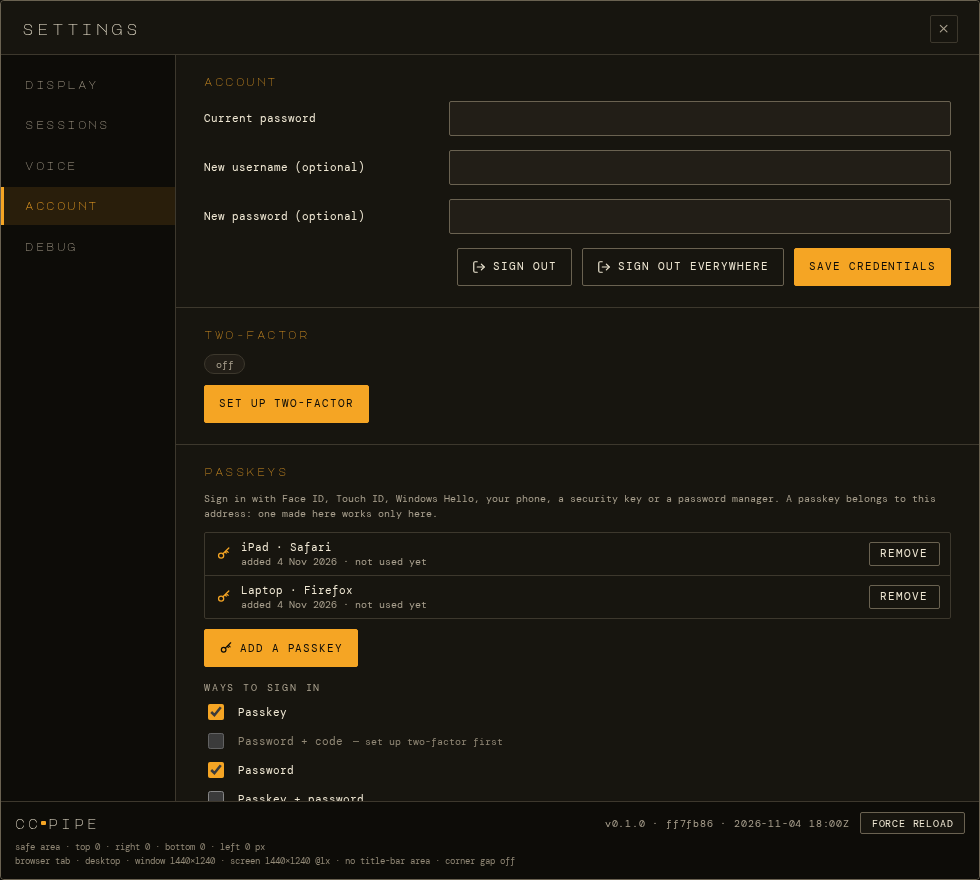
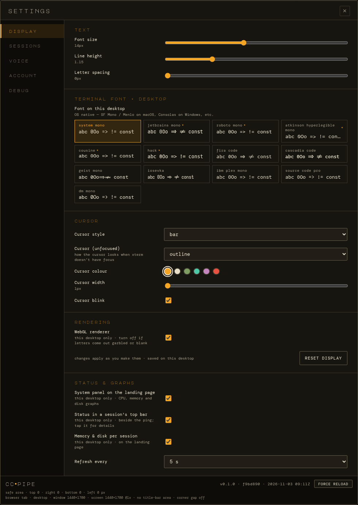

# Signing in and settings

[← Documentation](../README.md)

- [Signing in](#signing-in)
- [Passkeys](#passkeys)
- [Settings](#settings)

## Signing in

Sign-in is always on. Sign in with your password, plus a 6-digit code once
two-factor is set up (Settings → Account → *Set up two-factor*), or with a
passkey.

A login lasts until it goes 30 days unused. *Sign out* ends this one, and
*sign out everywhere* ends every login on every device.

The first password is generated at install; see
[Install → First sign-in](../install.md#first-sign-in).

  

## Passkeys

Sign in with Face ID, Touch ID, Windows Hello, your phone, a security key
or a password manager.

- **Add one** in Settings → Account → passkeys. Your device asks for your
  face, fingerprint or PIN, both when you add it and every time you sign
  in with it.
- **On the login page,** tap **Sign in with a passkey**, or pick the
  passkey from the username field's suggestions where the browser offers
  them (iPhone and Android keyboards, password managers).
- **You choose the ways in:** any of *passkey*, *password + code*,
  *password*, *passkey + password*, *passkey + code*, or all three. When a
  passkey isn't enough on its own, the login page asks for just what's
  missing once the passkey is accepted.
- **Changing sign-in needs your password** (and code): adding or removing
  a passkey, or changing the ways in. A stolen session can't add its own
  passkey or weaken sign-in.
- **The password stays a fallback** whenever none of the ways you chose
  can be used, so removing your last passkey doesn't lock you out.
- **Passkeys need HTTPS at a host name.** They don't work at an IP
  address or over plain HTTP, except on `localhost`.

Setup details and how to get back in from the shell are in
[Configuration → Passkeys](../configuration.md#passkeys).

  

## Settings

The gear opens Settings:

| Tab | What's in it |
|---|---|
| **Display** | Text size and spacing; the terminal font (per device); the cursor's style, colour and blink; the WebGL renderer switch; and *status & graphs*. Applies as you change it. |
| **Sessions** | How many sessions start at boot, and the idle stop times (see [Sessions](sessions.md#stopped-sessions-come-back)). |
| **Notifications** | What happens when Claude asks something or finishes in another session: a chime, the session's name said aloud, and push notifications for this device; how long to wait before pushing while ccpipe is open elsewhere; an open tab's own notification (see [When Claude needs you](notifications.md)). |
| **Voice** | Text-to-speech: voice, speed, what to read aloud (and whether to read Claude's progress notes). Voice input: when dictation stops and is sent, and voice processing on this device. |
| **Account** | Change the username or password, sign out, sign out everywhere, set up two-factor (TOTP), add or remove passkeys, and choose the ways to sign in. |
| **Debug** | A diagnostic snapshot (Ctrl+Shift+D) for terminal display bugs. |

The footer shows the build the page is running, with **Force reload**
(**Update ready · reload** once a newer build is deployed). Under it is a
readout of what the screen reports: safe-area insets, window and screen
size, and whether the page is an installed app. That's handy for checking
the layout on a new device.

  

