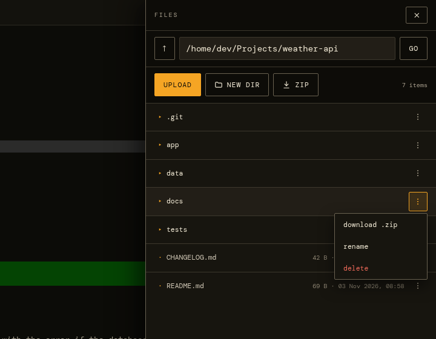
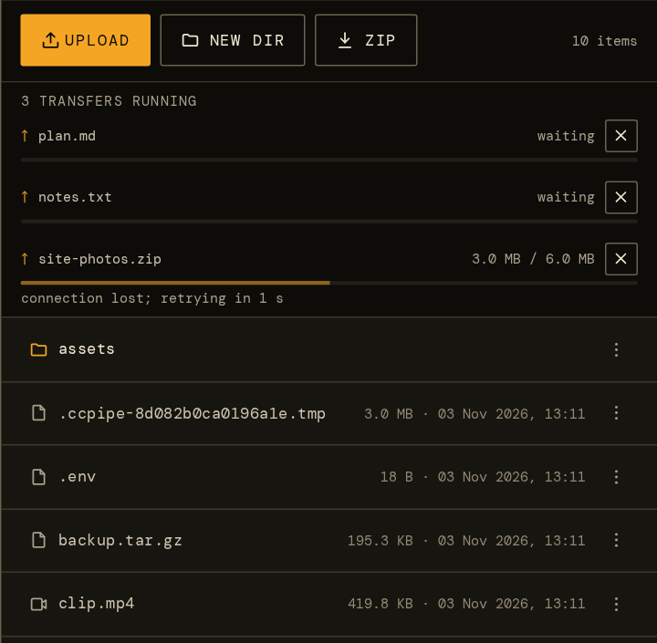
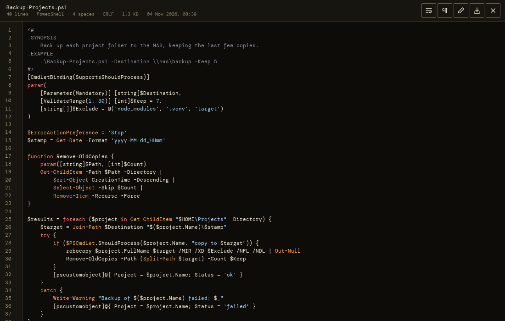
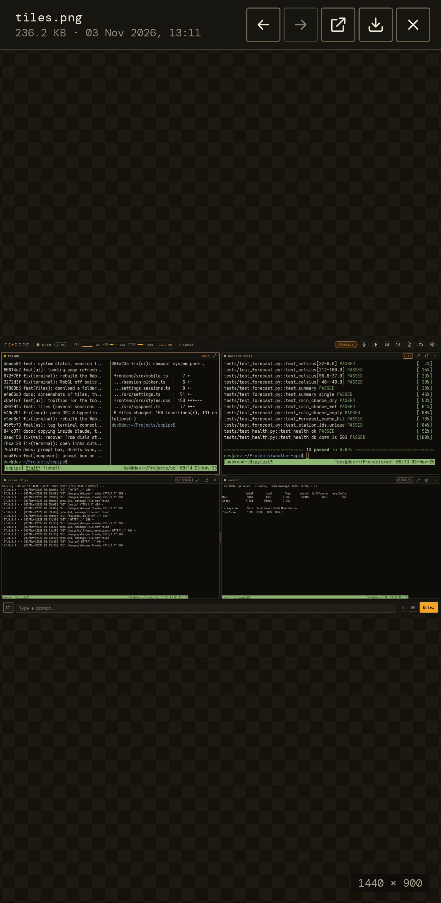
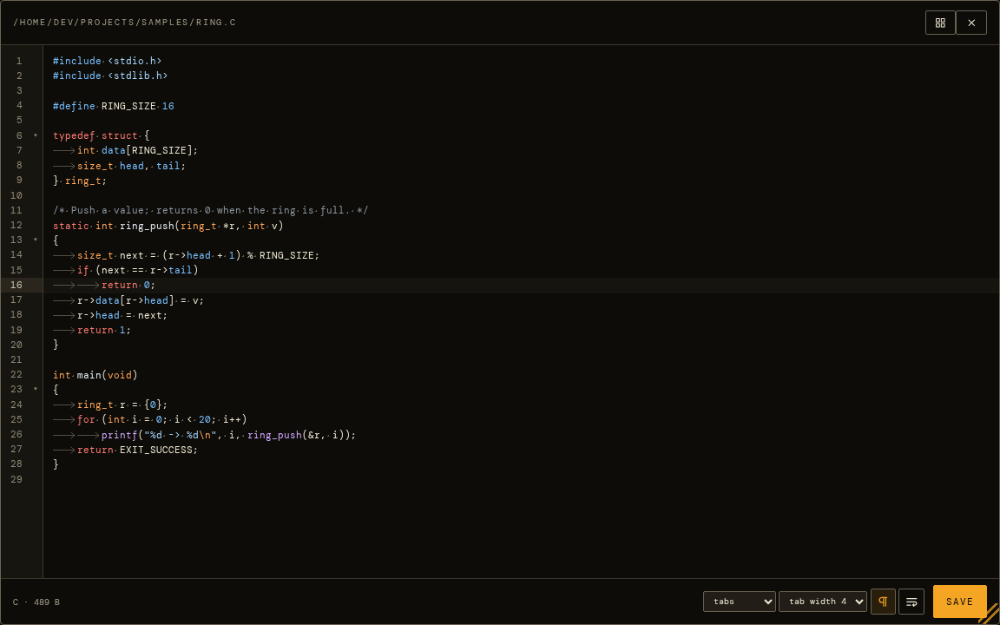
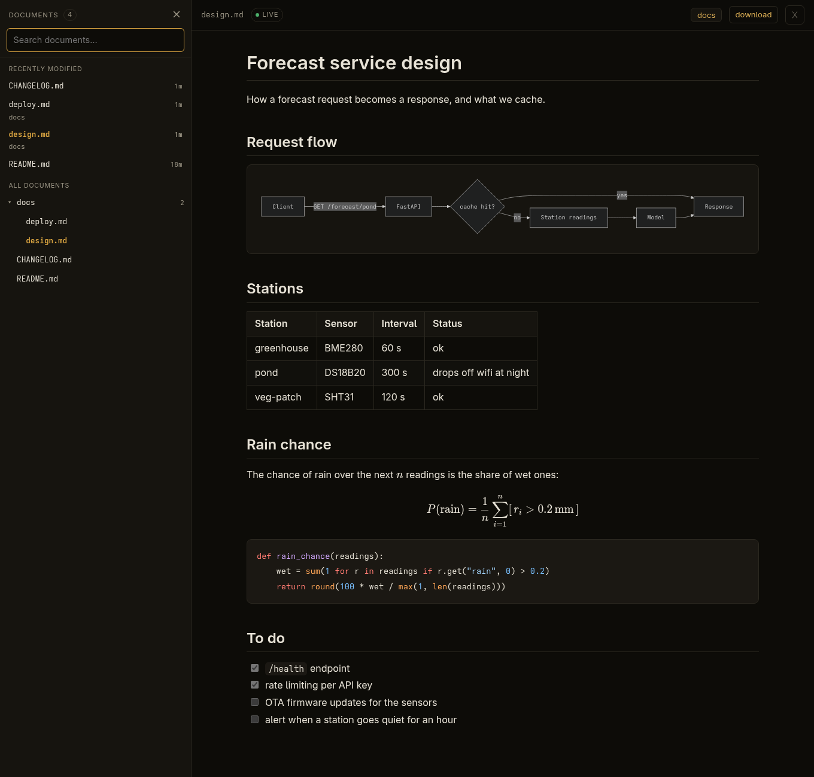
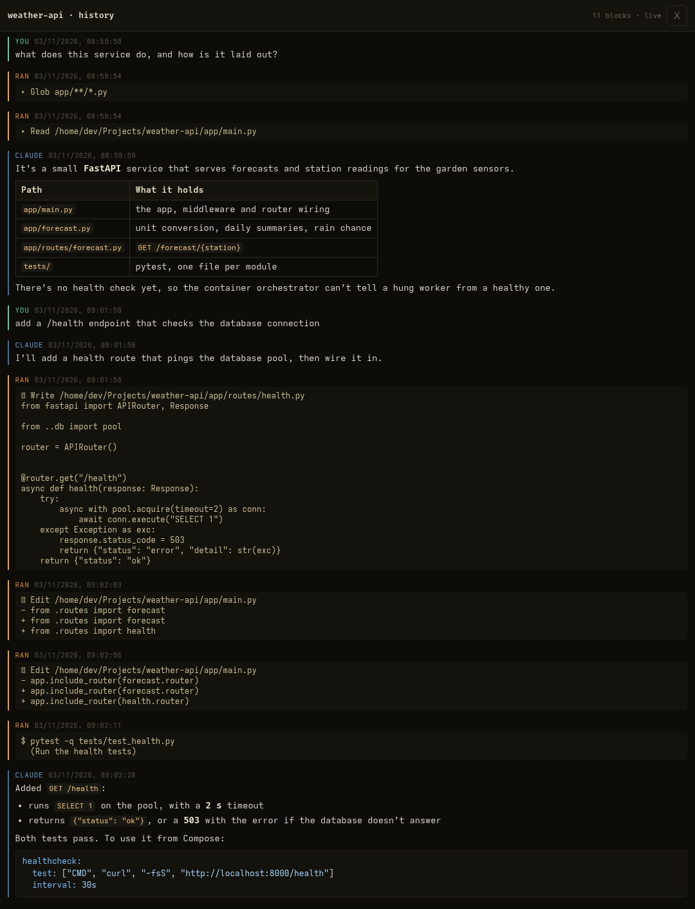

# Files, documents and history

[← Documentation](../README.md)

- [The file browser](#the-file-browser)
- [The file viewer](#the-file-viewer)
- [The editor](#the-editor)
- [The document viewer](#the-document-viewer)
- [Conversation history](#conversation-history)

## The file browser

The toolbar **Files** button opens a file browser at the session's
project folder. View, upload, create folders, rename, delete, edit text
files in place, and download.

- **Folders download as a .zip,** from a folder's ⋮ menu or the **zip**
  button for the folder you're in. It first shows how many files and how
  much data that is, and leaves hidden files (`.git`, `.venv`, …) out
  unless you choose to include them. The zip is built as it downloads, so
  there's no wait for a big folder to be packed first.
- **Upload** takes any number of files at once, from the picker or
  dropped onto the panel, up to 500 MB each (`fs.upload_limit_mb` in
  `config.json`). It asks before replacing files that are already there.
- **Built for bad connections.** Files travel in pieces of at most 8 MB,
  so a proxy's request-size limit (nginx, Cloudflare) doesn't cap them. A
  piece that fails is retried after a growing pause, from however much
  the server says has arrived, so a dropped signal costs only the piece in
  flight. Coming back online retries at once, and downloads are fetched
  the same way, in byte ranges.
- **The transfer list** shows each one's progress, speed and, on a bad
  link, *retrying in 4 s*; cancel or retry it there. Closing the panel
  doesn't stop a transfer, and the page won't update itself while one is
  running.

  
  &nbsp;
  

## The file viewer

Tapping a file opens it read-only, full screen. **✎** switches to the
editor, and closing the editor brings you back to the viewer.

- **Text and code** are coloured by language, with line numbers, a wrap
  toggle, and **¶** to show tabs and spaces.
  - About 150 languages are recognised from the file name, or from the
    `#!` line of a script with no extension. They include PowerShell,
    batch files, JavaScript and TypeScript, Python, Rust, C and C++, C#,
    Go, Java, shell, SQL, HTML, CSS, YAML, TOML, Dockerfiles and
    Makefiles.
  - The bar shows the language, how the file is indented (tabs or *n*
    spaces), and CRLF line endings. Ctrl+F searches the whole file.
- **Markdown** is rendered (see [the document viewer](#the-document-viewer)),
  with a switch to the source.
- **Images** fit the screen. Pinch, scroll or double-tap to zoom, and drag
  to pan. SVGs show as images, so any script in one never runs.
- **PDF, audio and video** use the browser's own viewer and players.
  Seeking works.

**‹ ›**, the arrow keys, or a swipe on an image step through the folder's
files. **⤓** downloads the file, and **↗** opens it in a tab of its own.

  

  

## The editor

**✎** opens the file for editing, with the same colours. Tab and
Shift+Tab indent and outdent the line or the selected lines. Ctrl+F finds
and replaces, and Ctrl+S saves.

- **Tabs or spaces.** It indents the way the file already does, with tabs
  or the file's own number of spaces. The footer shows which, and you can
  change it there. **Convert** then re-indents the whole file to match,
  as one undo step.
- **Tab width and switches.** The footer also sets how wide a tab is (2,
  3, 4 or 8), and has the show-whitespace and wrap switches. These are
  remembered on the device. On a phone, long lines wrap unless you turn it
  off.
- **The file's format is kept.** Line endings (LF or CRLF) and a UTF-8
  byte-order mark stay as the file had them.
- **Touch screens,** whose keyboards have no Tab key, get indent and
  outdent buttons in the footer.

  

## The document viewer

Any Markdown file in your project opens fully rendered in its own browser
tab: GitHub-flavoured, with syntax highlighting, KaTeX maths and Mermaid
diagrams.

- **Opening one.** Use the file browser, the editor's preview button, or
  the toolbar **Docs** menu. The menu leads with your **Recent** documents
  and the **Recently modified** ones (with ages), above every `.md` under
  the session's project.
- **It updates live.** Edit the file, or let `claude` edit it, and the
  rendered view refreshes in place without moving your scroll position.
  A burst of edits is coalesced into one refresh, and diagrams that
  didn't change aren't redrawn. Images and relative links resolve
  against the document's own folder.
- **The docs drawer.** Inside the viewer, **docs** (or `/`) opens a
  drawer. Type to search every Markdown file in the project, or browse a
  folder tree that opens along the current document's path, with the same
  Recent and Recently modified sections on top. It docks beside the
  document on wide screens and is a full-height sheet on phones.
- **Closing it.** When ccpipe is installed as an app (no tab strip or back
  button), the **✕** at the top right closes the viewer and returns you to
  the terminal.

  

## Conversation history

The toolbar **🕘 History** button opens the session's Claude Code
transcript in its own tab, rendered like a console.

- **The whole conversation:** your prompts, Claude's replies as rendered
  Markdown, and the commands run and files edited in between (`$ …` for
  shell commands, `✎` for edits with `-/+` diffs).
- **Live:** new replies and tool calls stream in as they happen,
  following the bottom while you read. Older history loads as you scroll
  up.

Claude Code's full-screen interface keeps no scrollback of its own, so
this is the place to look back through what happened.

  

