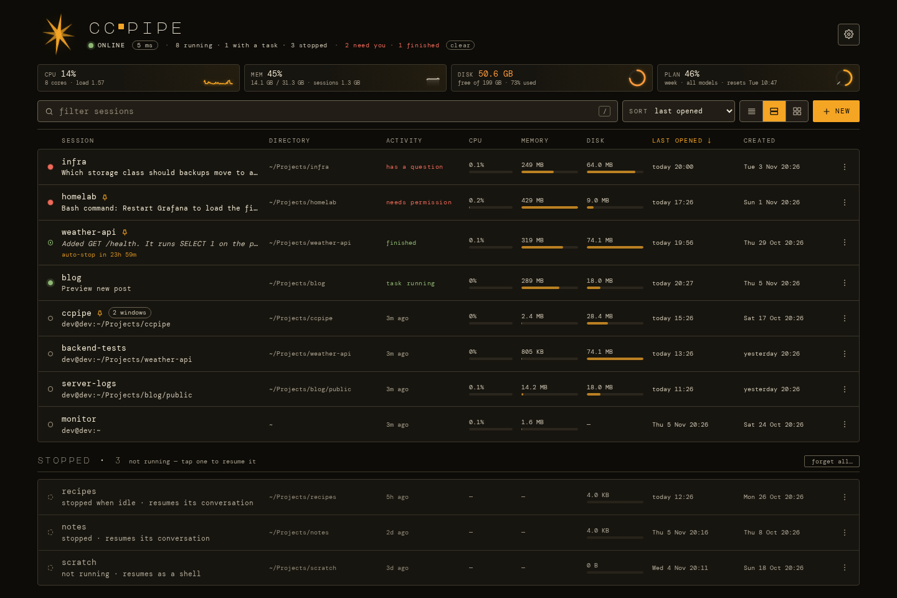
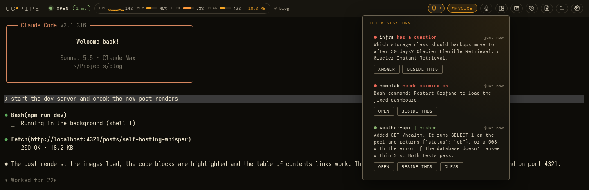
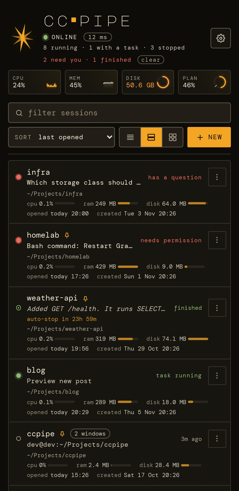
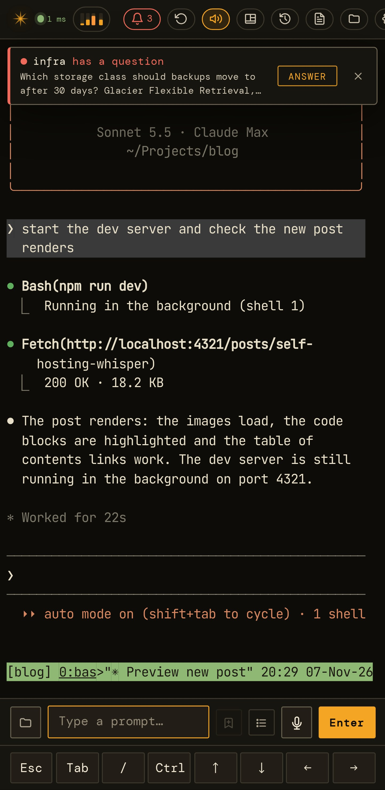
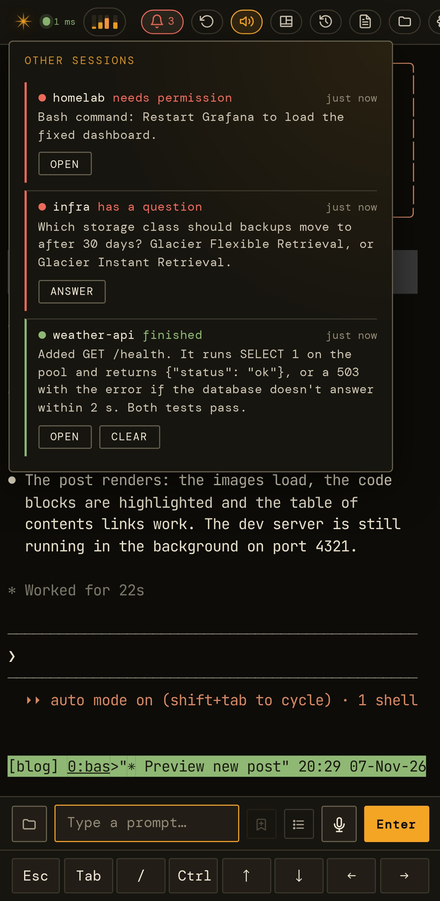

# When Claude needs you

[← Documentation](../README.md)

- [What counts](#what-counts)
- [On the session list](#on-the-session-list)
- [In another session](#in-another-session)
- [Push notifications](#push-notifications)
- [Settings](#settings)
- [How it's noticed](#how-its-noticed)

## What counts

ccpipe watches every session, not only the one you have open, for two
things:

- **Claude is asking you something.** It has stopped on a question (its
  multiple-choice dialog) or a permission prompt ("Do you want to
  proceed?"). This is urgent: nothing happens until you answer. It lasts
  until you do.
- **Claude has finished.** It was working, its turn is over, and no page
  was showing the session at the time. This is quiet: it waits for you.
  It's cleared as soon as a page shows the session, Claude starts working
  again, or you clear it.

A turn that finishes while you're watching the session isn't flagged:
you saw it.

## On the session list

A session that's asking has a pulsing red dot, says **has a question** or
**needs permission**, and shows the question itself in place of Claude's
task. A finished one has a green ring, says **finished** (hover for when),
and shows the end of Claude's reply. The header adds what needs you to its
summary, such as *2 need you · 1 finished*, with **clear** to dismiss the
finished ones.

  

Sessions that are asking go to the top when the list is sorted (when you
open it, change the sort, or come back to it), with finished ones next.
In between, rows stay where they are, so nothing moves under your finger.

The list checks every 3 seconds. When something new needs you, it tells
you which session:

- A banner at the top names it, with what it's asking or how its reply
  ended, and **Answer** or **Open**. It covers the row being out of sight.
- Its row flashes, red for a question and green for a finished turn.
- A chime plays, and then the session's name is said in ccpipe's voice:
  *"infra has a question."*

What plays is set in [Settings](#settings).

## In another session

While you're in one session, a **bell** appears in the top bar whenever
another session needs you. It's red with a count while one is asking,
green when they've only finished. Tap it for the list: each session, what
it's asking or how its reply ended, and how long ago, with:

- **Answer** (a question) or **Open**: go to that session.
- **Beside this:** open it as a tile next to this one, on an iPad or a
  desktop.
- **Clear:** dismiss a finished turn (**Clear all finished** for every
  one).

  

When something new arrives, a banner drops in under the top bar for a
few seconds, with the same Answer or Open. A chime plays, two rising
notes for a question and one soft note for a finished turn, and the
session's name is said in ccpipe's voice: *"weather api has a
question."* The tab's title counts what's waiting, such as *(2) ccpipe*,
and so does the app icon's badge where the browser has one.

The chime and the name don't take over the lock screen's media
controls, so pressing play there still plays your music, and ccpipe's
sound runs only while they play. On an iPad or iPhone with iOS 27,
though, any sound from a web page pauses music or a podcast in another
app: Safari routes a page's sound the way it routes a music app's. There,
turn off **Sound** and **Say it** for that device, and turn on **Also
while ccpipe is open here** under push notifications (below). The
notification then brings the sound, played by the system rather than the
page. With Sound and Say it off, and Claude's voice muted, the page plays
no sound at all.

The session you're in, and any in tiles beside it, are on screen, so
they're left out. This session's own question is read out in full, as it
always was (see [Voice](voice.md#when-claude-asks-you-something)).

<table>
<tr>
<td align="center"></td>
<td align="center"></td>
<td align="center"></td>
</tr>
<tr>
<td align="center">The list shows who needs you…</td>
<td align="center">…a banner when a question comes up…</td>
<td align="center">…and the bell lists them all.</td>
</tr>
</table>

## Push notifications

Push notifications reach a device even when ccpipe isn't on its screen,
or is closed. Turn them on for each device in **Settings →
Notifications → Turn on**. The browser asks for permission, and a test
notification follows.

- **iPad and iPhone:** only ccpipe added to the Home Screen (Share → Add
  to Home Screen) can have them. Turn them on from there.
- **Android:** Firefox and Chrome both work.
- **Desktop browsers** work too, while the browser is running.
- They need ccpipe over HTTPS, like the microphone.

Tapping a notification opens its session. A notification for a question
you've since answered is removed the next time ccpipe is open on that
device.

### Which devices get one

- **Not a device with ccpipe on screen.** The page there shows it already.
  If you put that device away without answering, it gets the push then
  (for up to half an hour).
- **Straight away** when ccpipe isn't on screen anywhere.
- **After a wait** when ccpipe is on screen on another device: one minute
  by default, in case you answer it there. If it's been answered by then,
  nothing is sent.

Each device chooses what it's told: questions and permission prompts (on
by default), finished turns (off by default), and whether the notification
shows the question or the reply, or only which session (for a lock
screen). **Send a test** checks the path end to end. Settings lists every
device that has push on, and **Remove** turns it off for a device you no
longer have.

### What the push service sees

A notification travels through your browser maker's push service:
Mozilla's for Firefox, Apple's for an iPad or iPhone, Google's for Chrome.
It is encrypted for your device, so the service relays it without being
able to read it. It does see that a message went to that device, and
when. ccpipe signs each one with its own key (made on first use and kept
in `push.json`), so no one else can push to your devices. Nothing here
touches Claude's login or Anthropic.

### If none arrive

- **Send a test** says what the push service answered. A device whose
  subscription has expired is removed by itself; turn push on again
  there.
- **Blocked:** notifications are switched off for ccpipe in the browser's
  or the phone's settings. Allow them there, then **Turn on**.
- **Android:** a battery saver that restricts the browser can hold
  notifications back until you open it.
- **iPad, iPhone:** check that Focus isn't silencing ccpipe.

## Settings

**Settings → Notifications**:

  

| | Sound | Say it | Push |
|---|---|---|---|
| **Questions & permission** (urgent) | on | on | on |
| **Finished turns** (quiet) | on | off | off |

- **Sound** and **Say it** are for this device and kept in this browser.
  They apply on the session list and in a session. With several ccpipe
  tabs open, only one of them rings or speaks. Say it uses ccpipe's
  voice, so it needs voice set up. It stays quiet on a session page whose
  voice is muted, and when Voice → *What to read aloud* is Off. Turning
  Sound on plays the chime.
- **Push** is this device's subscription. Its choices are kept on the
  server with it.
- **Also while ccpipe is open here** sends this device its notifications
  even while ccpipe is on its screen, straight away, so their sound can
  stand in for the page's (for an iPad, above). It's off by default: the
  page's banner is enough elsewhere.
- **While ccpipe is open on another device, wait** applies to every
  device: don't wait, 30 s, 1, 2, 5 or 15 minutes.
- **Notify from an open tab in the background** is the browser
  notification an open, hidden tab shows. It used to be *Notify when
  backgrounded* under Voice. On a device with push on, push does this
  instead, so you don't get both.

A phone or tablet only chimes or speaks from the page in front. A desktop
tab behind others can still chime.

## How it's noticed

Claude Code keeps a small file per running Claude,
`~/.claude/sessions/<pid>.json`, with its status: busy, idle, or waiting
for you. ccpipe reads these once a second for every session. When one
starts waiting, ccpipe reads the dialog off Claude's screen, since Claude
only writes the question to its transcript after you've answered it. A
turn counts as finished once Claude has been idle for 3 seconds after
working, and the end of its reply comes from the conversation's
transcript.

A question already waiting when ccpipe starts is listed but not
announced, so a restart doesn't ring every device again. A session
waiting for you is never stopped for being idle (see
[Sessions](sessions.md#stopped-sessions-come-back)).
