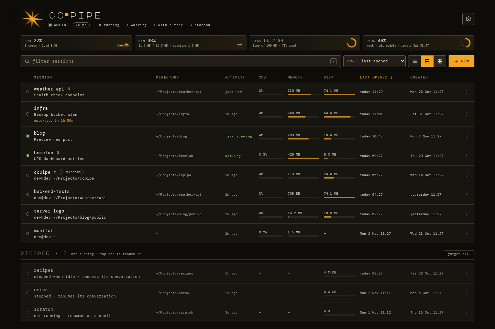
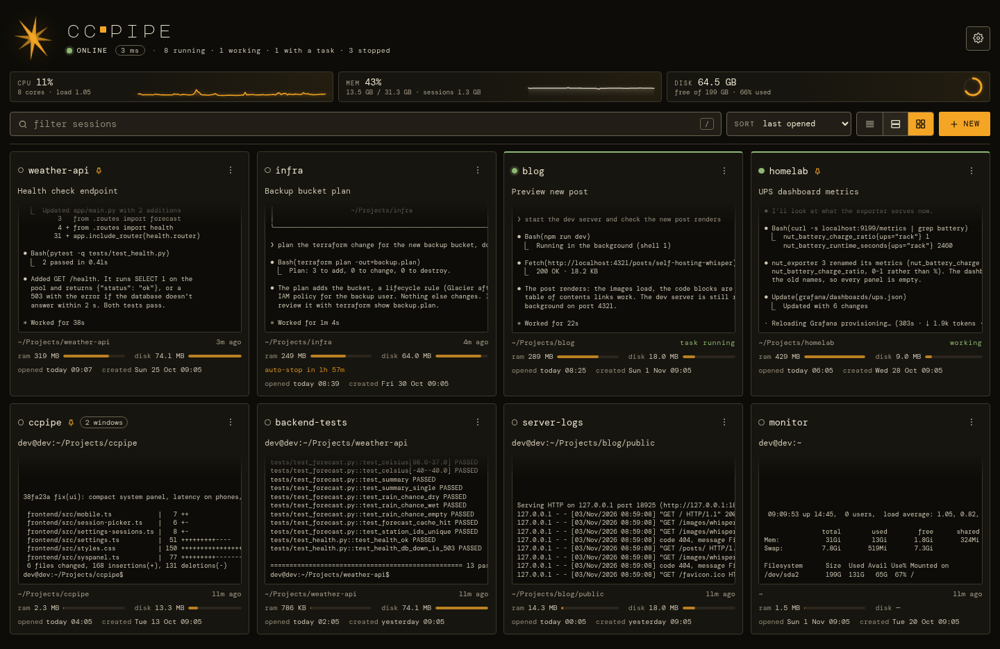
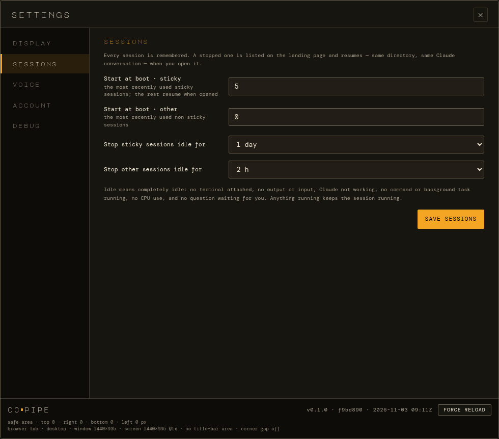
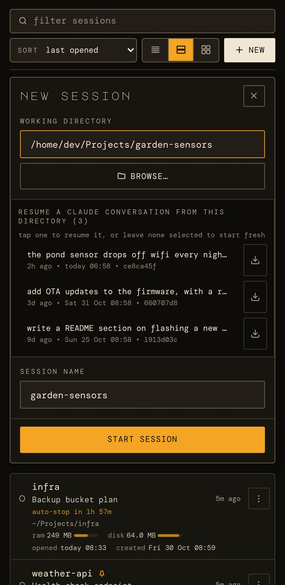
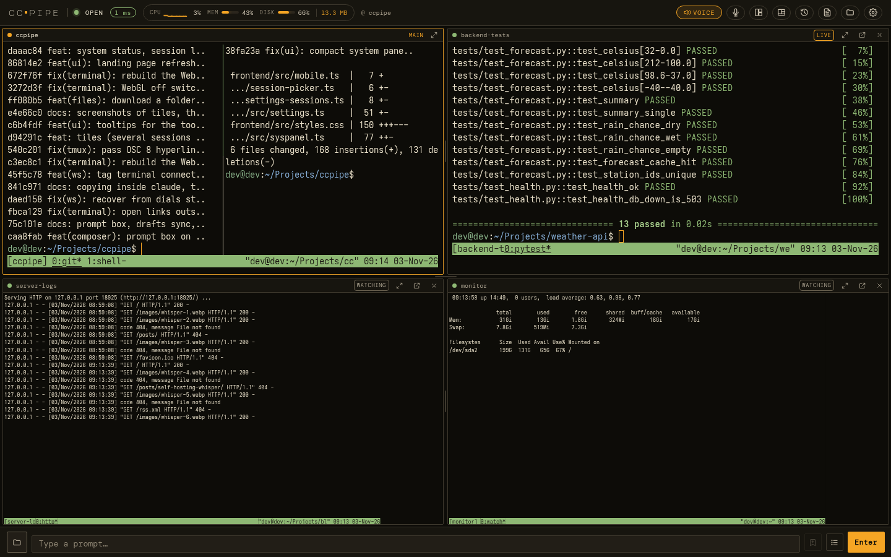
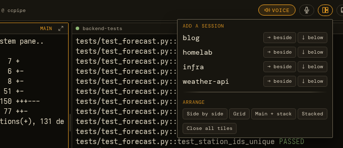
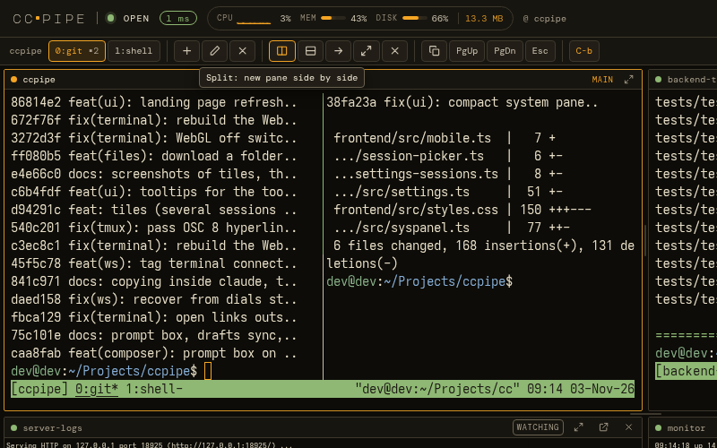

# Sessions

[← Documentation](../README.md)

- [The session list](#the-session-list)
- [Stopped sessions come back](#stopped-sessions-come-back)
- [Starting a session](#starting-a-session)
- [Tiles: several sessions on one screen](#tiles)
- [tmux controls](#tmux-controls)

## The session list

The landing page lists every session, running or stopped. The header
shows whether the server is online, the round-trip time, and a summary
such as *8 running · 1 working · 1 with a task · 3 stopped*. Below it
are the machine's CPU and memory, each with ten minutes of history, its
free disk space, and how much of your Claude plan you've used (see
[Status](status.md)).

  

Each session shows:

- **What Claude is working on:** the task Claude Code puts in the pane
  title.
- **Its state:** **working** while Claude is on a turn, **task running**
  while a background shell task runs, idle otherwise, and **open** while
  a terminal is attached somewhere.
- **Its directory and resources:** CPU, memory and project size.
  - CPU reads like `top`: 100% is one core busy, so a session using three
    cores shows 300%.
  - It covers Claude and everything it started, including short commands
    that finished between two readings, averaged over about 15 seconds.
- **When it was last active,** last opened and first created.
- **A pin** if it's sticky, and how many windows it has.
- **auto-stop in 1h 57m** when it's idle and will be stopped (see below).

Filter by name, task or directory (`/` jumps to the filter box). Sort by
recent activity, last opened, newest, name, CPU, memory or disk. Pick a
compact list, a detailed table, or a grid of live screen previews. Each
session's `⋮` menu opens, renames, stops or forgets it, or makes it
sticky. Settings → Display → *status & graphs* turns the system panel
and the per-session figures off on that device.

  

### How ccpipe knows Claude is working

ccpipe reads Claude Code's own status file
(`~/.claude/sessions/<pid>.json`: busy, idle, or idle with a background
shell task) rather than guessing from the screen. A long tool call that
prints nothing for minutes still counts as working.

## Stopped sessions come back

A session that isn't running stays on the list under **stopped**. That
happens after a reboot, after an idle stop, or after you stop it from its
menu. Tap it and it comes back: same name, same directory, and
`claude --resume` on the conversation it was on. A session that never ran
Claude (a shell you started over ssh, say) resumes as a shell in its
directory instead. *Forget* removes a session for good.

Under Settings → Sessions:

- **Start at boot.** After a reboot, only the most recently used few
  start by themselves: 5 sticky sessions and 0 others by default. The rest
  wait until you open them. Restarting ccpipe (a deploy, say) starts
  nothing and leaves stopped sessions stopped.
- **Idle stop.** Sessions that sit idle are stopped to free their memory,
  after 1 day for sticky sessions and 2 hours for others (0 = never).
  Idle is deliberately hard to reach. A session counts as in use while
  any of these holds:
  - a terminal is attached;
  - its pane shows output;
  - Claude is working, or has a background task or tool command running;
  - anything else runs in its shell;
  - it uses CPU;
  - a question or permission prompt is waiting.

  Only sessions running Claude are ever stopped, and every stop is logged.

Two edge cases:

- **The directory is gone.** Opening the session says so and leaves its
  record alone. It never quietly starts a fresh Claude in `$HOME`.
- **A terminal has the session open.** Stopping or forgetting it sends
  that terminal back to the list with a note ("weather-api was stopped")
  rather than reconnecting.

  

The details are in
[Configuration → Remembered, stopped and sticky sessions](../configuration.md#remembered-stopped-and-sticky-sessions).

## Starting a session

**+ new** opens a panel. Pick a working directory (type it or
**browse…**) and a session name, which is filled in from the directory.

If Claude has conversations from that directory, they're listed by their
first prompt and age. Tap one to resume it, or leave none selected to
start fresh. The ↓ beside each one downloads that conversation as
Markdown.

  

## Tiles

On an iPad or a desktop, the toolbar **tiles** button adds other sessions
beside or below the terminal you're in, so you can keep an eye on several
at once. Drag the dividers to resize, or pick a preset: side by side,
grid, main + stack, stacked.

- **Watching or live.** Each tile starts out **watching**: a read-only
  view that never resizes the session, so watching a session doesn't
  reflow it on your other devices. Click into a tile and start typing (or
  tap its *watching* label) and it goes **live**. Your keys, the prompt
  box and the tmux controls then act on that session.
- **New output** lights up a tile's header. **⤢** gives it the whole
  screen for a moment, and **↗** makes it the main session.
- **Remembered per session,** on the server: open the same session on
  another device and its tiles come back. On a phone the screen is too
  narrow, so the terminal stays full screen and the tiles wait for a
  bigger screen.

  

  

## tmux controls

The toolbar **tmux** button opens a slim row of tmux controls for the
focused session:

- **Windows:** tabs (click to switch), new, rename and close.
- **Panes:** split side by side or top/bottom, next pane, zoom, close.
- **Copy mode** with page up and page down.
- **C-b**, the prefix key, for anything else.

Each button runs a fixed tmux command on the server, so nothing you type
there reaches tmux's command line. Hover over any toolbar icon, or press
and hold it on a touch screen, to see what it does.

  

