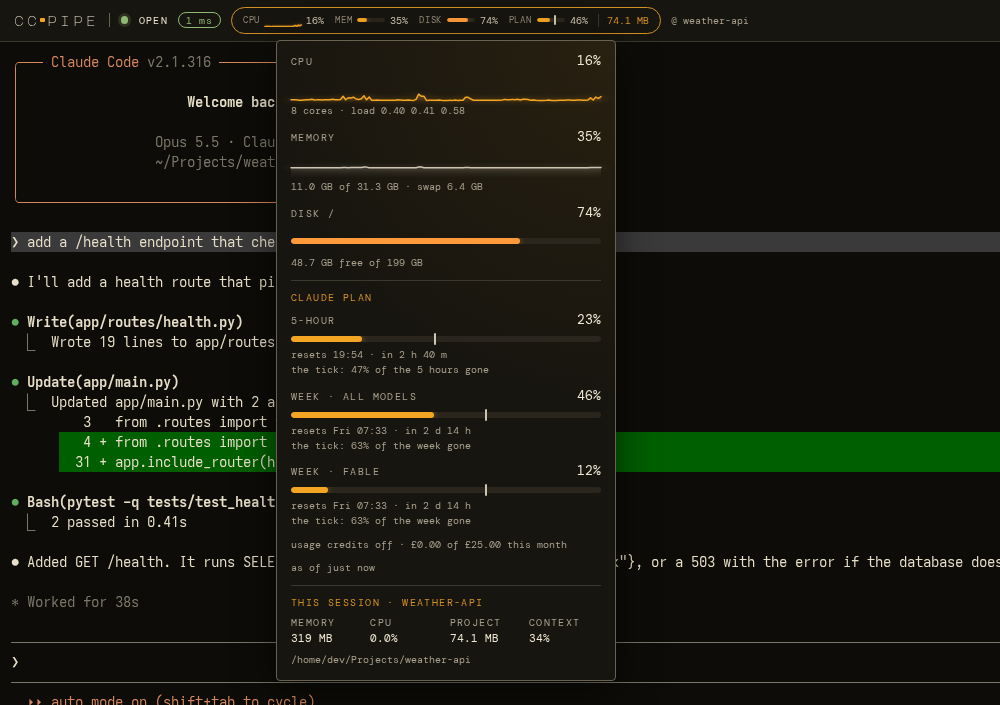
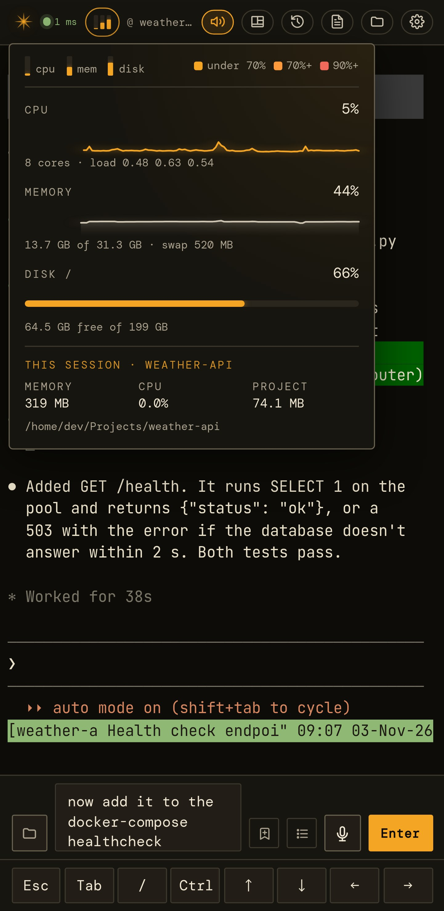
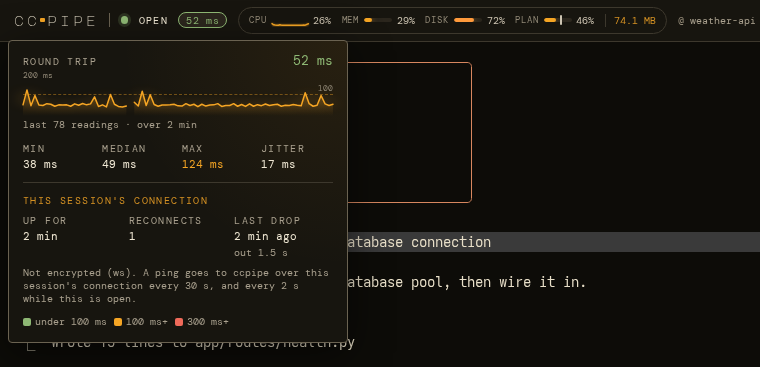
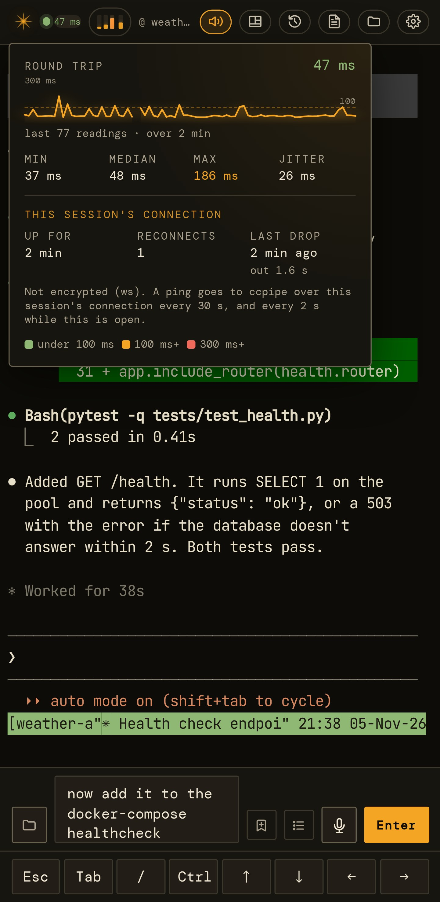

# Status: the machine, the connection and your Claude plan

[← Documentation](../README.md)

- [System status](#system-status)
- [The connection](#the-connection)
- [Claude plan usage](#claude-plan-usage)

## System status

Beside the ping in a session's top bar:

- **On a wide screen** there's a CPU graph, memory and disk bars, and the
  project's size.
- **On a phone or a narrow window** that becomes four thin bars: CPU,
  memory, disk and Claude plan usage, from left to right. Each bar is
  amber below 70 %, orange from 70 % and red from 90 %.

Click or tap it for a pop-up with the graphs and the exact figures. It
also shows this session's own memory (its whole process tree), CPU (as
in `top`, 100% per core) and project size. On the compact meter the
pop-up starts with a key to the bars, and tapping it on a phone doesn't
close the soft keyboard.

Each part can be switched off per device, and the refresh interval set
(2–30 s), under Settings → Display → *status & graphs*. A part that's
switched off stops asking the server too.

  

  

## The connection

The coloured dot and the ping beside it show how the connection to
ccpipe is doing: green under 100 ms, amber to 300 ms, red beyond. In a
session's top bar it's that session's own connection; on the landing
page it's the server. Click or tap them for a drop-down:

- **Round trip:** the latest reading, and a graph of the readings since
  the page opened. The graph's scale grows to fit them (it's never under
  50 ms), dashed lines mark 100 ms and 300 ms once the readings reach
  that high, and a break in the line is where the connection dropped.
- **Min, median, max and jitter:** the spread of those readings. Jitter
  is how much one reading differs from the next, on average.
- **The connection's ups and downs** (*this session's connection* in a
  session, *the ccpipe server* on the landing page):
  - **Up for:** how long since it last connected. While it's down this
    reads **down for**, counting from the first failure, even on a page
    that has never connected.
  - **Reconnects** (**outages** on the landing page): how many times it
    has gone down since the page opened.
  - **Last drop:** when it last went down, and how long it was out.
  - Underneath, whether it's encrypted (`wss` / `https` behind your HTTPS
    proxy, `ws` / `http` at a plain address).

  

  

### How it's measured

- **In a session,** a ping goes over the session's own WebSocket and the
  server answers it at once. Each answer carries its ping's number, so a
  slow answer is timed against the right ping, even with several out.
- **On the landing page,** it times a request to the server
  (`/api/health`). A request with no answer within 4 s counts as down,
  and the page reads *no answer*.
- **How often:** a session pings every 30 s and the landing page checks
  every 5 s. While the drop-down is open, both measure every 2 s so the
  graph moves, and they go back to their usual pace when it closes.
- **What's kept:** nothing. The readings start when the page opens and
  go when it's closed or reloaded. An update waits while the drop-down
  is open, so it doesn't wipe them under you.

### Reading it

- **High but steady** round trips are distance: a phone on mobile data,
  or a server far away.
- **High jitter,** or spikes past the amber line, means a busy or weak
  network: crowded Wi-Fi, or a weak mobile signal.
- **Reconnects every few minutes** on a phone usually mean the network
  or the browser is closing connections. ccpipe dials again by itself,
  and after a short gap it carries on without redrawing the screen.

It opens and closes like the status pop-up: tap it again, tap anywhere
else, or press Escape (which doesn't reach Claude). On a phone, tapping
it doesn't close the soft keyboard. On the landing page, a swipe that
starts on it scrolls the page as usual.

## Claude plan usage

The top bar, its pop-up and the landing page also show how much of your
Claude subscription's usage limits you've used.

- **The top bar and the landing page** show one figure: the meter
  Anthropic picks for a single readout, usually the week across all
  models. On a phone it's the fourth bar in the meter.
- **The pop-up** lists every meter Anthropic reports for your plan, each
  with when it resets. That can be the weekly limit for all models, a
  weekly limit for one model, or the 5-hour window on plans that have
  one. A tick on each bar marks how much of its window has gone, so a bar
  reaching past its tick is using the plan faster than an even pace.
  Below them are your usage credits and how old the figures are.
- **This session** in the pop-up adds how full its context window is.

The figures come from Claude Code itself, so ccpipe never touches your
Claude login:

- **After each reply,** from what Claude gives its status line. ccpipe
  starts Claude with a status-line command that records it and then runs
  your own status line, so Claude's footer doesn't change. Sessions
  already running when you update ccpipe start reporting once they're
  restarted or resumed.
- **Every 15 minutes while ccpipe is open**, and when you open the pop-up
  on figures more than 5 minutes old, ccpipe runs `claude -p /usage`. That
  makes no model call and uses no tokens, and it also sees use from
  claude.ai, the apps and other machines. One run takes about 13 s of one
  CPU core and up to 400 MB of memory.

Settings → Display → *status & graphs* → *Claude plan usage* hides it on
one device. To turn it off altogether, or change how often it checks, see
[Configuration → Claude plan usage](../configuration.md#claude-plan-usage).
