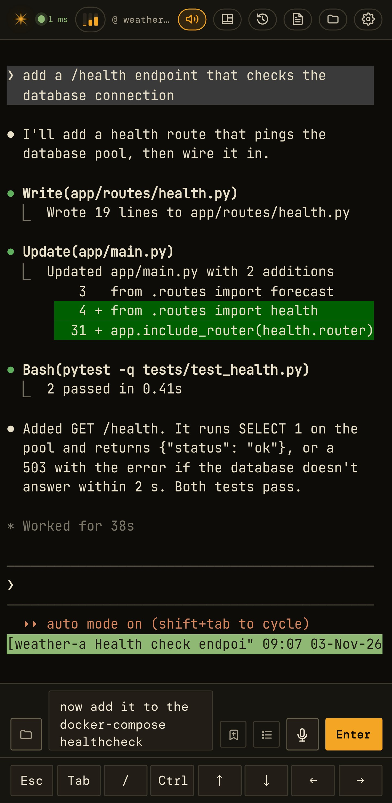

# Using a session

[← Documentation](../README.md)

- [The prompt box](#the-prompt-box)
- [Copying and links](#copying-and-links)
- [Phones and tablets](#phones-and-tablets)
- [Staying connected](#staying-connected)
- [Updates without a reload](#updates-without-a-reload)

  

## The prompt box

Under the terminal, on phones, tablets and desktop, is a prompt box for
composing longer prompts. **Enter** sends.

- **Drafts follow you.** Whatever you type is the session's draft. It's
  kept on the server, comes back whenever you re-enter the session, and
  syncs live between devices: type on the phone and see it appear on the
  iPad (the last edit wins). Sending clears it everywhere.
- **Saved prompts.** The bookmark button saves the box's contents under a
  name. The list button drops down your saved prompts (filterable, with a
  preview and delete) and inserts the one you pick at the cursor. Saved
  prompts are shared by every session and every device.
- **On desktop,** keystrokes go straight to the terminal until you click
  into the box.

## Copying and links

Select text and it's copied to your clipboard; a toast confirms it and
shows what was copied.

- **Inside `claude`,** which captures the mouse, a normal drag selects in
  Claude's own UI and Claude copies it. Hold **Shift** while dragging to
  select the terminal text directly instead.
- **Links** printed in the terminal open in your browser (a new tab, or
  the in-app browser on a phone), leaving ccpipe where it was. A long
  link that Claude wraps over several lines opens in full from any of
  them.

## Phones and tablets

Installed to the home screen, ccpipe runs full screen.

- **Keys.** A row of keys sits above the soft keyboard: Esc, Tab, `/`,
  Ctrl and the arrows. Phone keyboards can't send Ctrl combinations
  themselves.
- **Prompt box.** The folder button inserts a file or folder path, and
  the mic dictates (see [Voice](voice.md)).
- **Soft keyboard.** The terminal re-fits when the keyboard opens. The
  key row and the status meter keep the keyboard up when you tap them.
- **Scrolling.** Dragging up scrolls Claude's own view, the same as a
  mouse wheel on a desktop.
- **Top bar.** On a phone the back-to-sessions button is the spark mark,
  so the session name has room.
- **iPad.** iPadOS 26 draws its window buttons over the top-left corner
  of a home-screen app. ccpipe's top bar starts clear of them there, and
  the ✕ that closes the viewer and the history view sits top right for
  the same reason.
- **Display.** The terminal font is chosen per device. If letters come
  out garbled on one device, switch its WebGL renderer off there alone
  (Settings → Display).

## Staying connected

The terminal reconnects by itself: after a dropped signal, after
switching between Wi-Fi and mobile data, or when you come back to the
app. A connection attempt stuck on a network that's gone is abandoned
after 10 seconds and retried, and returning to the app redials straight
away, so you shouldn't need to reload.

## Updates without a reload

After a deploy, open pages move to the new build by themselves, at a
moment that loses nothing:

- straight away on the session list;
- otherwise when the app comes back from the background, or after ten
  idle minutes.

It never happens with a dialog open, mid-dictation, during a file
transfer, or while the terminal is scrolled back. A small toast offers to
reload sooner. Until then the old page keeps working, because each build
keeps the files of the last three builds.
