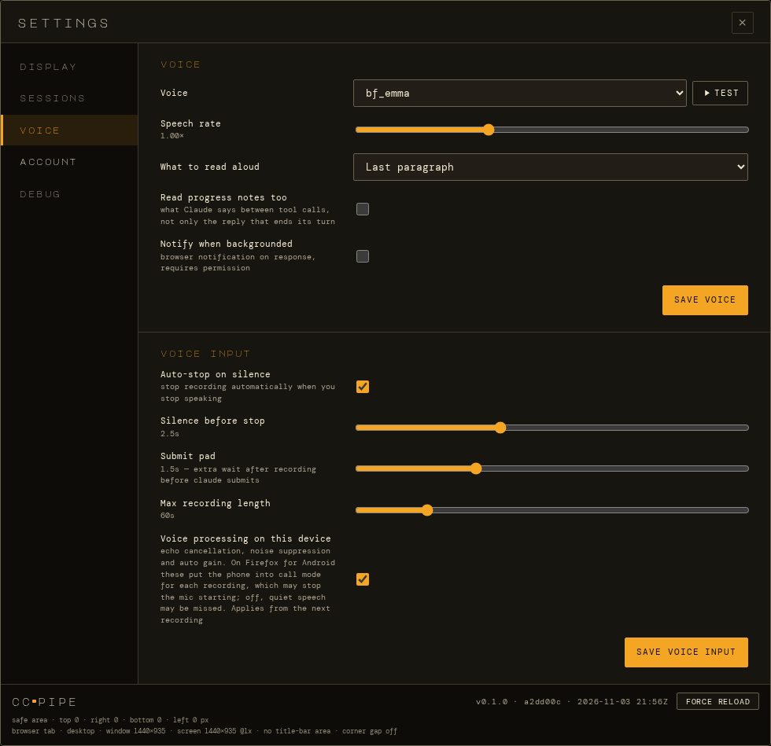

# Voice

[← Documentation](../README.md)

- [Dictation](#dictation)
- [Spoken replies](#spoken-replies)
- [When Claude asks you something](#when-claude-asks-you-something)

Voice needs some setup on the host: a software microphone for dictation,
and a text-to-speech server ([Kokoro](https://github.com/remsky/Kokoro-FastAPI))
for spoken replies. See [Configuration → Voice setup](../configuration.md#voice-setup).
The microphone and notifications need ccpipe over HTTPS.

  

## Dictation

Tap the mic and talk. Tap it again, or just stop talking, to send. A
waveform shows it's hearing you.

The audio goes to Claude Code's own `/voice` through a software
microphone on the host, and Claude transcribes it into the prompt. ccpipe
starts and stops Claude's recording itself and checks Claude's screen
each time, so the two stay in step:

- **Start again straight away** and both recordings go through. If Claude
  is still transcribing the last one, the mic waits for it (*Waiting for
  Claude to finish the last recording…*).
- **Claude recording on its own** (you pressed Alt+K in the terminal,
  say) shows *Claude is listening · tap to talk*. Tap it and talk into
  that recording.
- **One device at a time.** While one device dictates, the mic on another
  says it's in use.
- **If the mic can't start,** a message says why: access refused, no
  microphone, or *tap the mic to try again*.

Voice processing (echo cancellation, noise suppression, auto gain) is on
by default, because Claude hears you better with it. On Firefox for
Android it puts the phone into call mode for each recording, which seems
to be why the mic occasionally failed to start there. A switch in
Settings → Voice turns it off on that device alone.

## Spoken replies

With TTS on, ccpipe reads out Claude's reply when it finishes a turn.

- **How much is read:** Settings → Voice → *What to read aloud* picks the
  full reply, its first or last paragraph, its first or last sentence, or
  its closing question.
- **Only Claude's reply** is read. Your prompts, subagents' output and the
  notes Claude writes between tool calls ("Now I'll run the tests.")
  aren't. *Read progress notes too* adds those notes back.
- **Read the way a person would say it:** no "asterisk" around bold text,
  a file path as its file name, and `→` as "to".
- **The replay button** repeats the whole reply.

On an iPad or iPhone, Safari plays sound only after you've tapped the
page, and again after the app has been in the background. Speech that
arrives before then isn't lost: the speaker button pulses, a note says
*Tap anywhere to hear Claude*, and your next tap or key press plays it.
The small playback visualiser isn't shown on those devices, because
routing the sound through it made Safari cut the audio off. If voice
stays silent, see [Deployment → Production troubleshooting](../deployment.md#production-troubleshooting).

## When Claude asks you something

When Claude stops on a question (its multiple-choice dialog) or a
permission prompt, ccpipe reads it out: *"Claude asks: Which colour do
you prefer? Red, or Blue."* or *"Claude needs your permission. Bash
command: delete hello.txt…"*.

When it's another session that's asking, the voice says which one (*"weather
api has a question"*), and a bell and a banner show it. Turn either
off, or the chime, in Settings → Notifications. To be told on a phone
in your pocket, use push notifications. See
[When Claude needs you](notifications.md).

With *Notify from an open tab in the background* on (Settings →
Notifications; it used to be *Notify when backgrounded* here), a hidden tab
also shows a notification, even when voice is muted. A reply that ends in
a question is notified as a question too.

Claude only writes a question to its transcript after you've answered
it, so ccpipe spots the wait in Claude's session file and reads the
dialog off the screen.
